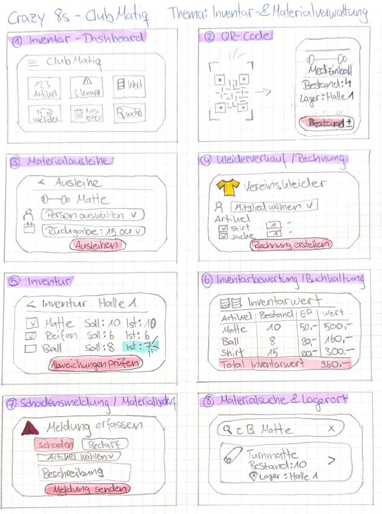

# Projektdokumentation - ClubMatiq

## Projektübersicht & Zugänge

| Angabe | Inhalt |
|---|---|
| Projekttitel | ClubMatiq – Digitale Material-, Inventar- und Vereinskleiderverwaltung |
| Verfasser/in | Jennifer Mentner, WIN-03-23HS-TZDSRH *(Angabe aus bisheriger README; vor Abgabe prüfen)* |
| GitHub-Repository | https://github.com/JenSusann/ClubMatiq |
| Aktuelle App | https://clubmatiq.netlify.app |
| Getestete Version | **Noch ergänzen:** URL der separat deployten Testversion und Commit/Tag. Dokumentationsbasis: [`9f2e7bc`](https://github.com/JenSusann/ClubMatiq/commit/9f2e7bc816b91b1f3878c4c269f2403f143fc4f9), 17.11.2026; dies ist **kein Nachweis einer getesteten Version**. |
| Testzugänge | **Noch ergänzen:** Bereitstellungsweg für eigens angelegte Testkonten je Rolle; keine Passwörter im öffentlichen Repository |
| Figma / Referenz-Mockup | **Noch ergänzen:** direkter Link zum Referenz-Mockup |
| Weitere Artefakte [Optional] | [Crazy 8s](docs/images/crazy8s.png) · [User Journey Map](docs/images/user-journey.png) · [GitHub Issues](https://github.com/JenSusann/ClubMatiq/issues) |

> **Zugriff:** Vor der Abgabe sicherstellen, dass die Dozierenden auf Repository, App und verlinkte Artefakte zugreifen können.

> **Testzugänge:** Keine persönlichen Passwörter, API-Schlüssel oder MongoDB-Zugangsdaten im Repository veröffentlichen. Testkonten gegebenenfalls separat bereitstellen.

## Inhaltsverzeichnis

[Projektübersicht & Zugänge](#projektübersicht--zugänge)

- [1. Ausgangslage](#1-ausgangslage)
- [2. Lösungsidee](#2-lösungsidee)
- [3. Vorgehen & Artefakte](#3-vorgehen--artefakte)
    - [3.1 Understand & Define – Problemraumanalyse](#31-understand--define--problemraumanalyse)
    - [3.2 Sketch](#32-sketch)
    - [3.3 Decide](#33-decide)
    - [3.4 Prototype](#34-prototype)
        - [3.4.1. Entwurf (Design)](#341-entwurf-design)
        - [3.4.2. Umsetzung (Technik)](#342-umsetzung-technik)
    - [3.5 Validate](#35-validate)
- [4. Erweiterungen \[Optional\]](#4-erweiterungen-optional)
    - [4.1 Software-Erweiterungen](#41-software-erweiterungen)
        - [4.1.1 Digitale Inventur mit Korrekturhistorie und PDF](#411-digitale-inventur-mit-korrekturhistorie-und-pdf)
        - [4.1.2 Vereinskleiderverkauf und Bestellabwicklung](#412-vereinskleiderverkauf-und-bestellabwicklung)
        - [4.1.3 Sammelbestellungen und PDF-Export](#413-sammelbestellungen-und-pdf-export)
        - [4.1.4 Verrechnung, Stornierung und Verkaufshistorie](#414-verrechnung-stornierung-und-verkaufshistorie)
        - [4.1.5 Anmeldung, Benutzerverwaltung und Berechtigungen](#415-anmeldung-benutzerverwaltung-und-berechtigungen)
        - [4.1.6 QR-Code, Materialsuche und Inventarbewertung](#416-qr-code-materialsuche-und-inventarbewertung)
    - [4.2 Weitere Erweiterungen](#42-weitere-erweiterungen)
        - [4.2.1 GitHub-basiertes Issue- und Änderungsmanagement](#421-github-basiertes-issue--und-änderungsmanagement)
        - [4.2.2 Strukturierter KI-gestützter Entwicklungsworkflow](#422-strukturierter-ki-gestützter-entwicklungsworkflow)
        - [4.2.3 Datenmodell](#423-datenmodell)
        - [4.2.4 Systematische Testmatrix und Testprotokolle](#424-systematische-testmatrix-und-testprotokolle)
        - [4.2.5 Anforderungs- und Rückverfolgungsmatrix](#425-anforderungs--und-rückverfolgungsmatrix)
        - [4.2.6 Rollenbasiertes Berechtigungskonzept](#426-rollenbasiertes-berechtigungskonzept)
- [5. Projektorganisation \[Optional\]](#5-projektorganisation-optional)
- [6. KI-Deklaration](#6-ki-deklaration)
    - [6.1 KI-Tools](#61-ki-tools)
    - [6.2 Vorgehen mit KI](#62-vorgehen-mit-ki)
        - [6.2.1 Konzeption und Gestaltung](#621-konzeption-und-gestaltung)
        - [6.2.2 Implementierung und Fehlersuche](#622-implementierung-und-fehlersuche)
        - [6.2.3 Prompt-Vorgehen und Kontext](#623-prompt-vorgehen-und-kontext)
        - [6.2.4 GitHub-gestützter Entwicklungsworkflow](#624-github-gestützter-entwicklungsworkflow)
    - [6.3 Reflexion](#63-reflexion)
    - [6.4 Abgrenzung der Eigenleistung](#64-abgrenzung-der-eigenleistung)
    - [6.5 Qualitätssicherung und Überprüfung der KI-Ergebnisse](#65-qualitätssicherung-und-überprüfung-der-ki-ergebnisse)
    - [6.6 Datenschutz, Sicherheit und Urheberrecht](#66-datenschutz-sicherheit-und-urheberrecht)
    - [6.7 Nachvollziehbarkeit und Verantwortung](#67-nachvollziehbarkeit-und-verantwortung)
- [7. Anhang \[Optional\]](#7-anhang-optional)
    - [Projektartefakte](#projektartefakte)
    - [Quellen und Urheberrecht](#quellen-und-urheberrecht)
- [8. Inventurverwaltung – technischer Funktionsstand](#8-inventurverwaltung--technischer-funktionsstand)
    - [8.1 Inventur anlegen, zählen und verwalten](#81-inventur-anlegen-zählen-und-verwalten)
    - [8.2 Abschluss, Korrekturen und Stornierung](#82-abschluss-korrekturen-und-stornierung)
    - [8.3 Inventurverlauf und Korrekturhistorie](#83-inventurverlauf-und-korrekturhistorie)
    - [8.4 Inventurbericht als PDF](#84-inventurbericht-als-pdf)
    - [8.5 Wichtige Dateien und API-Routen](#85-wichtige-dateien-und-api-routen)
    - [8.6 Relevante Datenbank-Collections](#86-relevante-datenbank-collections)
- [9. Lokale Installation und Tests](#9-lokale-installation-und-tests)
    - [9.1 Voraussetzungen](#91-voraussetzungen)
    - [9.2 Qualitätskontrolle](#92-qualitätskontrolle)
    - [9.3 Automatisierte Tests](#93-automatisierte-tests)
    - [9.4 Code Coverage und Qualitätsziel](#94-code-coverage-und-qualitätsziel)
    - [9.5 Manuelle System- und Abnahmetests](#95-manuelle-system--und-abnahmetests)
    - [9.6 Usability-Tests und Evaluation](#96-usability-tests-und-evaluation)
    - [9.7 Test- und Abnahmeprozess](#97-test--und-abnahmeprozess)
- [10. Technische Architektur, Integrationen und Entwicklungsstand](#10-technische-architektur-integrationen-und-entwicklungsstand)
    - [10.1 Architektur und technische Entscheidungen](#101-architektur-und-technische-entscheidungen)
    - [10.2 Funktionsübersicht und Modulverknüpfungen](#102-funktionsübersicht-und-modulverknüpfungen)
    - [10.3 Externe Dienste und Schnittstellen](#103-externe-dienste-und-schnittstellen)
    - [10.4 E-Mail-Versand und Konfiguration](#104-e-mail-versand-und-konfiguration)
    - [10.5 Sicherheit, Datenintegrität und Nachvollziehbarkeit](#105-sicherheit-datenintegrität-und-nachvollziehbarkeit)
    - [10.6 Entwicklungsstand und Qualitätssicherung](#106-entwicklungsstand-und-qualitätssicherung)
    - [10.7 Offene Aufgaben bis zur Abgabe](#107-offene-aufgaben-bis-zur-abgabe)
    - [10.8 Abgrenzung zur Produktivsetzung und Weiterentwicklung](#108-abgrenzung-zur-produktivsetzung-und-weiterentwicklung)


## 1. Ausgangslage

- **Problem:** In ehrenamtlich geführten Vereinen werden Inventar, Lagerorte, Materialausleihen und Vereinskleider oft in separaten Listen oder durch persönliche Absprachen verwaltet. Informationen zu Beständen, Verfügbarkeit, Verantwortlichkeiten und finanziellen Werten sind dadurch nicht zentral verfügbar. Besonders bei Kleiderverkäufen, Nachbestellungen und Inventuren entstehen zusätzliche manuelle Arbeitsschritte.
- **Ziele:** Eine zentrale Webanwendung soll Artikel und Bestände übersichtlich verwalten, Ausleihen und Rückgaben dokumentieren, Inventuren unterstützen und die Verwaltung von Vereinskleidern bis zur Verrechnung nachvollziehbar machen. Die Bedienung soll auch für ehrenamtliche Personen mit wenig IT-Erfahrung verständlich sein.
- **Primäre Zielgruppe:** Materialverantwortliche, Trainingsleitende und weitere Personen, die Vereinsmaterial verwalten oder ausleihen.
- **Weitere Stakeholder:** Kassiererin für Inventarbewertung und Verrechnungen, Verantwortliche für Vereinskleider, Vereinsvorstand und Vereinsmitglieder. Der Turnverein Weiningen bildet den praktischen Anwendungskontext.

## 2. Lösungsidee

- **Kernfunktionalität:** ClubMatiq verbindet Inventarverwaltung, Stammdaten, Materialsuche, QR-Codes, Ausleihen, Inventuren, Inventarbewertung, Meldungen und Vereinskleiderverwaltung in einer SvelteKit-Webanwendung. Artikel werden Kategorien und Lagerorten zugeordnet; Kleidungsartikel können Grössenvarianten und eigene Bestände besitzen. Ausleihen und Rückgaben werden dokumentiert. Die Inventur umfasst Bestandsaufnahme, Abschluss, Korrekturen, Historie und PDF-Ausgabe. Für Vereinskleider bestehen Oberflächen und API-Routen für Verkäufe, Bestellungen, Sammelbestellungen, Übergaben, Preisverwaltung, Stornierungen, Verrechnung und Verkaufshistorie. Eine Anmeldung und serverseitige Berechtigungslogik sind im Repository vorhanden.
- **Annahmen:** Eine gemeinsame Datenbasis verringert doppelte Erfassung und erleichtert die Suche nach Material. Verständliche Abläufe und eine rollenbezogene Darstellung verbessern die Nutzbarkeit. Grössen- und Preisvarianten sind für Vereinskleider erforderlich.
- **Abgrenzung:** ClubMatiq ist ein Prototyp und kein nachgewiesen produktiv abgesichertes Vereins-ERP. Eine vollständige Finanzbuchhaltung und eine nachgewiesene ClubDesk-Integration gehören nicht zum belegten Umfang. Implementierte Funktionen bedeuten nicht automatisch, dass sämtliche fachlichen Randfälle oder Sicherheitsanforderungen erfolgreich getestet wurden.

## 3. Vorgehen & Artefakte

Das Projekt folgt dem phasenorientierten Prototyping-Prozess. Die nachfolgenden Angaben verbinden die bisherigen Projektunterlagen mit dem am 17.11.2026 eingesehenen Repository-Stand.

### 3.1 Understand & Define – Problemraumanalyse

- **Zielgruppenverständnis:** Ausgangspunkt war die Verwaltung von Vereinsmaterial im Alltag. Als konkrete Perspektiven wurden eine Kassiererin (Jennifer), eine Leiterin (Nathalie), eine Materialverantwortliche (Laura) und die Zuständigkeit für Rechnungen bzw. Kleiderverrechnung betrachtet. Diese Rollen machen unterschiedliche Informationsbedürfnisse sichtbar.
- **Wesentliche Erkenntnisse:**
  - Materialverantwortliche benötigen zuverlässige Bestände, Lagerorte und Informationen zu beschädigtem Material.
  - Leitende möchten Material schnell finden und seine Verfügbarkeit einschätzen.
  - Die Kassiererin benötigt nachvollziehbare Inventarwerte und Informationen für Verrechnungen.
  - Vereinskleider erfordern eine Verwaltung nach Artikel und Grösse sowie die Trennung von Bestellung, Ausgabe und Zahlung.
  - Wenige, verständliche Bedienungsschritte sind für ehrenamtliche Nutzung wichtig.

**Leitfrage:** Wie kann eine zentrale, einfach bedienbare Anwendung den Überblick über Vereinsinventar und Materialbewegungen verbessern und zugleich die Verwaltungsarbeit reduzieren?
**Artefakt:** [Problemraumanalyse und Ideenfindung](docs/konzeption/problemraumanalyse.pdf)

### 3.2 Sketch

- **Variantenüberblick:** In der Ideensammlung wurden unter anderem eine zentrale Startseite, Inventarlisten, Artikeldetails, eine Materialsuche, QR-Code-Zugriffe und einfache Ausleihprozesse betrachtet. Die Ideen wurden über Crazy 8s und anschliessende Skizzen konkretisiert.
- **Skizzen:** Das Artefakt [Crazy 8s](docs/images/crazy8s.png) dokumentiert den frühen Entwurf. Die Varianten unterscheiden sich insbesondere darin, ob der Einstieg über Funktionen, Materialsuche oder einzelne Artikel erfolgt. **Noch ergänzen:** weitere Handskizzen bzw. eine kurze Bildlegende, sofern in der Abgabe verlangt.

**Artefakt:** [Proto-Personas, Crazy 8s, Skizzen und User Journey](docs/konzeption/sketch-personas-entscheidung.pdf)




### 3.3 Decide

- **Gewählte Variante & Begründung:** Gewählt wurde eine funktionsorientierte Webanwendung mit einer zentralen Startseite und separaten Bereichen. Das unterstützt unterschiedliche Aufgaben und ermöglicht eine schrittweise Erweiterung. Ein gemeinsamer Artikelbestand dient als Grundlage für Inventar, Ausleihen, Inventur und Vereinskleider.
- **End-to-End-Ablauf:** Beispiel: Eine Leiterin sucht Material, prüft die Artikeldetails und erfasst eine Ausleihe; bei der Rückgabe wird die Ausleihe aktualisiert. Ein weiterer Ablauf umfasst die Auswahl von Vereinskleidern, die Erfassung einer Bestellung bzw. eines Verkaufs und die spätere Übergabe und Verrechnung. Die frühe [User Journey Map](docs/images/user-journey.png) dokumentiert die Nutzerperspektive; der zweite Ablauf ist eine spätere funktionale Erweiterung.
- **Mockup:** Link siehe «Figma / Referenz-Mockup» in der [Projektübersicht](#projektübersicht--zugänge). **Noch ergänzen:** Referenz-Mockup und Screenshots mit kurzen Bildbeschreibungen.

**Nachweis:** [Entscheidungsreflexion, Seite 6](docs/konzeption/sketch-personas-entscheidung.pdf#page=6)


### 3.4 Prototype

#### 3.4.1. Entwurf (Design)

- **Informationsarchitektur:** Die Startseite dient als Einstieg in die Module. Die Anwendung ist nach Aufgabenbereichen strukturiert: Inventar, QR-Code, Ausleihen, Vereinskleider, Inventur, Inventarbewertung, Meldungen, Materialsuche und Stammdaten. Die Vereinskleiderverwaltung ist zusätzlich in Bestand, Verkauf, Bestellungen, Sammelbestellungen, Verrechnung und Historie gegliedert.
- **User Interface Design:** Die Benutzeroberfläche nutzt getrennte Listen-, Detail- und Formularseiten. Inventarartikel können über eigene Seiten angelegt, bearbeitet und angezeigt werden. Für Vereinskleider stehen eigene Arbeitsoberflächen für Bestandsverwaltung, Verkauf und Folgeprozesse zur Verfügung. **Noch ergänzen:** echte Screenshots der wichtigsten Ansichten mit kurzen Erläuterungen.
- **Designentscheidungen:** Funktionskacheln vereinfachen den Einstieg; separate Detailseiten reduzieren die Komplexität umfangreicher Formulare. Stammdaten werden unabhängig von Bewegungsprozessen gepflegt. Die Vereinskleiderprozesse sind getrennt, damit Bestellungen, Übergaben und Verrechnungen nachvollziehbar bleiben.

#### 3.4.2. Umsetzung (Technik)

**Technologiewahl:** Für die Umsetzung wurde SvelteKit mit Svelte 5 und TypeScript gewählt. Dadurch lassen sich Benutzeroberfläche und serverseitige API innerhalb eines gemeinsamen Projekts entwickeln. MongoDB ermöglicht die flexible Speicherung von Artikeln, Grössenvarianten und vereinsbezogenen Geschäftsdaten. Als Entwicklungswerkzeuge dienen Visual Studio Code, Node.js/npm, GitHub und ChatGPT. Die Webanwendung wird über Netlify bereitgestellt.

**Vorgehen bei der Implementierung:** Der Prototyp wurde schrittweise aufgebaut und anhand der fachlichen Anforderungen erweitert.

1. Aufbau der Projektstruktur, Datenbankanbindung und Stammdatenverwaltung.
2. Umsetzung der Inventarverwaltung sowie der Ausleih- und Rückgabeprozesse.
3. Erweiterung um Inventuren, Inventarbewertung und nachvollziehbare Bestandsbewegungen.
4. Ausbau der Vereinskleiderverwaltung um Verkäufe, Bestellungen, Beschaffung, Übergaben, Verrechnung und Retouren.
5. Weiterentwicklung der Benutzerverwaltung, Berechtigungen, Session-Verwaltung und externen Integrationen.
6. Laufende Qualitätssicherung, Fehlerkorrekturen und Erweiterung der automatisierten und manuellen Testfälle.

Die Entwicklung erfolgt iterativ anhand von GitHub-Issues. Fachliche Anforderungen werden konkretisiert, KI-gestützt in technische Lösungen übersetzt und anschliessend lokal integriert und geprüft. Erkenntnisse aus den Prüfungen fliessen in die nächste Entwicklungsiteration ein. Der Ablauf und die Abgrenzung der Eigenleistung sind in [Kapitel 6](#6-ki-deklaration) dokumentiert.

**Projektstruktur:** Die Anwendung trennt Benutzeroberfläche, serverseitige Schnittstellen und gemeinsam verwendete Geschäftslogik.

| Bereich | Ablage |
|---|---|
| Benutzeroberfläche und Navigation | [src/routes](src/routes) |
| Serverseitige API | [src/routes/api](src/routes/api) |
| Gemeinsame Komponenten und Logik | [src/lib](src/lib) |
| Datenbankzugriff und serverseitige Geschäftslogik | [src/lib/server](src/lib/server) |
| Automatisierte Tests | [tests](tests) |
| Projektartefakte und Testdokumentation | [docs](docs) |

**Zentrale technische Herausforderungen:** Besondere Aufmerksamkeit erforderte die konsistente Bestandsführung über mehrere Module hinweg. Ausleihen, Verkäufe, Wareneingänge, Retouren und Inventuren greifen auf gemeinsame Bestände zu. Weitere Herausforderungen waren die korrekte Zuordnung von Grössenvarianten, Teilrechnungen und Stornierungen sowie die Trennung der Vereinsdaten und rollenbezogenen Zugriffsrechte. Zur Unterstützung dieser Anforderungen wurden unter anderem serverseitige Validierungen, Transaktionen, Versionskontrollen und Historien in den dafür vorgesehenen Prozessen eingesetzt.

**Ergebnis der Umsetzung:** Aus dem ursprünglichen Entwurf entstand ein funktionsübergreifender Webprototyp, der die Material- und Vereinskleiderverwaltung auf einer gemeinsamen Datenbasis verbindet. Die Anwendung wird weiterhin anhand der definierten Anforderungen und Testergebnisse verbessert.

**Weiterführende technische Dokumentation:**

- [Kapitel 4.2.3 – Datenmodell](#423-datenmodell)
- [Kapitel 6 – KI-Deklaration](#6-ki-deklaration)
- [Kapitel 9 – Lokale Installation und Tests](#9-lokale-installation-und-tests)
- [Kapitel 10 – Technische Architektur, Integrationen und Entwicklungsstand](#10-technische-architektur-integrationen-und-entwicklungsstand)
- [Aktuelle Webanwendung](https://clubmatiq.netlify.app)

### 3.5 Validate

> Die Evaluation muss mit tatsächlich durchgeführten Tests und anonymisierten Nachweisen ergänzt werden. Die Existenz von Quellcode oder lokalen Fehlermeldungsprüfungen ersetzt keine Nutzerevaluation.

- **Getestete Version:** **Noch offen:** separat deployte Testversion mit URL und Commit/Tag in der Projektübersicht dokumentieren.
- **Ziele der Prüfung:** Verständlichkeit der Navigation; korrekte Erfassung und Suche von Inventarartikeln; Ausleihe und Rückgabe; korrekte Bestandsänderungen; Verständlichkeit der Vereinskleiderbestellung und Verrechnung; rollenbezogene Zugriffsbeschränkungen.
- **Vorgehen:** **Noch dokumentieren:** tatsächlich eingesetzte Testmethode, Testort und Moderation. Als mögliche Vorgehensweise eignet sich ein moderierter aufgabenbasierter Test mit anschliessendem kurzem Feedbackgespräch.
- **Stichprobe:** **Noch dokumentieren:** Anzahl, Rollenprofil und anonymisierte Angaben der tatsächlichen Testpersonen.
- **Aufgaben/Szenarien:** Für eine noch durchzuführende Evaluation werden folgende Aufgaben vorgeschlagen:
  1. Einen Artikel anhand seiner Bezeichnung finden und den Lagerort bestimmen.
  2. Eine Ausleihe erfassen und eine Teilrückgabe dokumentieren.
  3. Einen Kleidungsartikel in einer bestimmten Grösse verkaufen oder bestellen.
  4. Eine offene Bestellung in der Übersicht finden und die Übergabe nachvollziehen.
  5. Eine Inventur durchführen und eine Bestandsabweichung nachvollziehen.
  6. Mit einer eingeschränkten Rolle prüfen, ob administrative Aktionen verhindert werden.
- **Kennzahlen & Beobachtungen:** **Noch offen:** tatsächliche Erfolgsquote pro Aufgabe, Bearbeitungsdauer, Fehler, Rückfragen und qualitative Beobachtungen erfassen. Keine Messwerte ohne Testprotokoll angeben.
- **Nachweise:** **Noch ergänzen:** anonymisierte Testprotokolle, Auswertung und Screenshots oder Aufzeichnungen unter `docs/` ablegen und hier verlinken.
- **Zusammenfassung der Resultate:** Eine belegbare Zusammenfassung ist erst nach Durchführung und Auswertung der Tests möglich. Bis dahin lässt sich aus dem Repository lediglich die Implementierung, nicht aber die Nutzerfreundlichkeit oder Fehlerfreiheit ableiten.
- **Abgeleitete Verbesserungen:** Nach den Tests anhand von Schweregrad und Häufigkeit priorisieren; daraus GitHub Issues ableiten und umgesetzte Korrekturen mit Commits verlinken. **Noch ergänzen:** tatsächlich beobachtete Probleme und durchgeführte Verbesserungen.

## 4. Erweiterungen [Optional]

> **Wichtig:** Die nachfolgenden Funktionen sind als **mögliche** Software-Erweiterungen dokumentiert. Ob sie tatsächlich über den verbindlichen Mindestumfang hinausgehen und als Erweiterung zählen, muss anhand der Moodle-/Unterrichtsanforderungen geprüft werden. Für eine Bewertung sind Nachweise und Codereferenzen zu ergänzen.

### 4.1 Software-Erweiterungen

#### 4.1.1 Digitale Inventur mit Korrekturhistorie und PDF
- **Beschreibung & Nutzen:** Bestandsaufnahmen können über einen eigenen Inventurprozess erfasst, abgeschlossen und bei Bedarf korrigiert oder storniert werden. Eine Historie und PDF-Ausgabe unterstützen Nachvollziehbarkeit und Dokumentation.
- **Abgrenzung zum Mindestumfang:** Geht über eine einfache Artikelliste und manuelle Bestandsbearbeitung hinaus, sofern Inventur nicht bereits zum verbindlichen Mindestumfang gehört.
- **Umsetzung:** Eigene Inventurseiten und API-Routen für Abschluss, Korrektur, Korrekturhistorie, Zurücksetzen, Stornierung und PDF.
- **Nachweise:** [Inventur-Oberfläche](https://github.com/JenSusann/ClubMatiq/tree/main/src/routes/inventur) · [Inventur-API](https://github.com/JenSusann/ClubMatiq/tree/main/src/routes/api/inventuren) · **Screenshot ergänzen**.
- **Bezug zur Evaluation:** Nein; kein belegter Zusammenhang mit einer durchgeführten Nutzerevaluation vorhanden.

#### 4.1.2 Vereinskleiderverkauf und Bestellabwicklung
- **Beschreibung & Nutzen:** Vereinskleider werden nicht nur als Lagerartikel geführt, sondern über separate Verkaufs-, Bestell- und Übergabeprozesse bearbeitet. Das erleichtert die Nachverfolgung von Bestellungen und Bestandsbewegungen.
- **Abgrenzung zum Mindestumfang:** Erweitert die reine Inventar- und Grössenverwaltung um geschäftsprozessbezogene Vorgänge.
- **Umsetzung:** Eigene Ansichten für Verkauf, Bestellungen, Bestand und Historie sowie API-Endpunkte für Bestellungen und Übergaben.
- **Nachweise:** [Verkauf](https://github.com/JenSusann/ClubMatiq/blob/main/src/routes/vereinskleider/verkauf/%2Bpage.svelte) · [Bestell-API](https://github.com/JenSusann/ClubMatiq/blob/main/src/routes/api/vereinskleider/bestellungen/%2Bserver.ts) · [Übergabe-API](https://github.com/JenSusann/ClubMatiq/blob/main/src/routes/api/vereinskleider/bestellungen/uebergabe/%2Bserver.ts) · [Issue #34](https://github.com/JenSusann/ClubMatiq/issues/34) · **Screenshot ergänzen**.
- **Bezug zur Evaluation:** Nein; die Funktion wurde im Rahmen der fachlichen Erweiterung entwickelt, ohne hier nachgewiesenen Evaluationstest.

#### 4.1.3 Sammelbestellungen und PDF-Export
- **Beschreibung & Nutzen:** Mehrere Bestellungen können für eine gemeinsame Beschaffung aufbereitet werden. Eine PDF-Ausgabe unterstützt die Weitergabe der Bestellinformationen.
- **Abgrenzung zum Mindestumfang:** Ergänzt die Einzelbestellung um einen zusammengefassten Beschaffungsprozess.
- **Umsetzung:** Eigene Sammelbestellungsseiten und API-Endpunkte für einzelne und gemeinsame PDF-Ausgaben.
- **Nachweise:** [Sammelbestellungsseite](https://github.com/JenSusann/ClubMatiq/blob/main/src/routes/vereinskleider/sammelbestellungen/%2Bpage.svelte) · [PDF-Endpunkt](https://github.com/JenSusann/ClubMatiq/blob/main/src/routes/api/vereinskleider/sammelbestellungen/pdf/%2Bserver.ts) · [Commit `a011ff1`](https://github.com/JenSusann/ClubMatiq/commit/a011ff127515143f9feab1a581ad0bd9bdee8c57) · **Screenshot ergänzen**.
- **Bezug zur Evaluation:** Nein; kein entsprechender Testnachweis vorhanden.

#### 4.1.4 Verrechnung, Stornierung und Verkaufshistorie
- **Beschreibung & Nutzen:** Verkäufe können für die Verrechnung aufbereitet werden. Separate Prozesse für Stornierungen und eine durchsuchbare Historie verbessern die Nachvollziehbarkeit.
- **Abgrenzung zum Mindestumfang:** Geht über die reine Erfassung von Inventar- oder Kleiderbeständen hinaus und unterstützt administrative Folgeprozesse.
- **Umsetzung:** Verrechnungs-, Stornierungs- und Historienrouten einschliesslich PDF-Endpunkt für Verrechnungen.
- **Nachweise:** [Verrechnung](https://github.com/JenSusann/ClubMatiq/blob/main/src/routes/vereinskleider/verrechnung/%2Bpage.svelte) · [Stornierungs-API](https://github.com/JenSusann/ClubMatiq/blob/main/src/routes/api/vereinskleider/stornierungen/%2Bserver.ts) · [Historie](https://github.com/JenSusann/ClubMatiq/blob/main/src/routes/vereinskleider/historie/%2Bpage.svelte) · [Commit `2044bf7`](https://github.com/JenSusann/ClubMatiq/commit/2044bf7d9fc4508be1bc32ce678c2ab7c1b00499) · [Commit `9f2e7bc`](https://github.com/JenSusann/ClubMatiq/commit/9f2e7bc816b91b1f3878c4c269f2403f143fc4f9) · **Screenshot ergänzen**.
- **Bezug zur Evaluation:** Nein; kein entsprechender Testnachweis vorhanden.

#### 4.1.5 Anmeldung, Benutzerverwaltung und Berechtigungen

**Beschreibung & Nutzen:** ClubMatiq verfügt über eine vereinsbezogene Benutzerverwaltung mit Authentifizierung, rollenbasierten Berechtigungen und E-Mail-Einladungen. Neue Benutzer können durch berechtigte Personen eingeladen werden und ihr Konto selbstständig aktivieren. Dadurch wird die Benutzerverwaltung vereinfacht und der Zugriff auf Vereinsdaten kontrolliert.

**Abgrenzung zum Mindestumfang:** Zusätzlich zur fachlichen Materialverwaltung wurden eine zentrale Benutzerverwaltung, serverseitige Berechtigungsprüfungen und ein vollständiger Einladungsprozess mit externem E-Mail-Versand umgesetzt.

**Umsetzung:** Die Authentifizierung erfolgt über SvelteKit-API-Endpunkte und Sessions. Passwörter werden mit Argon2 gehasht. Einladungen werden über Resend versendet und über zeitlich begrenzte Tokens verarbeitet. Die Benutzerrollen und Einzelberechtigungen werden zentral verwaltet und bei geschützten API-Aufrufen geprüft.

**Nachweise:** [Benutzerverwaltung](https://github.com/JenSusann/ClubMatiq/tree/main/src/routes/benutzer) · [Berechtigungslogik](https://github.com/JenSusann/ClubMatiq/blob/main/src/lib/server/berechtigungen.ts) · [Resend-Einrichtung](https://github.com/JenSusann/ClubMatiq/blob/main/docs/resend-einladungen.md) · [Pull Request #59](https://github.com/JenSusann/ClubMatiq/pull/59)

**Bezug zur Evaluation:** Die Funktion wurde während der technischen Umsetzung lokal getestet. Eine separate Nutzerevaluation ist dadurch nicht ersetzt.

#### 4.1.6 QR-Code, Materialsuche und Inventarbewertung
- **Beschreibung & Nutzen:** Zusätzliche Funktionen unterstützen den schnellen Zugriff auf Materialinformationen, das Auffinden von Artikeln und die finanzielle Übersicht des Inventars.
- **Abgrenzung zum Mindestumfang:** Ergänzt die Basisverwaltung um Such-, Identifikations- und Auswertungsfunktionen, sofern diese nicht verbindlich gefordert sind.
- **Umsetzung:** Eigene Seiten für QR-Code, Materialsuche und Inventarbewertung; die Abhängigkeit `qrcode` ist im Projekt enthalten.
- **Nachweise:** [QR-Code](https://github.com/JenSusann/ClubMatiq/blob/main/src/routes/qr-code/%2Bpage.svelte) · [Materialsuche](https://github.com/JenSusann/ClubMatiq/blob/main/src/routes/materialsuche/%2Bpage.svelte) · [Inventarbewertung](https://github.com/JenSusann/ClubMatiq/blob/main/src/routes/inventarbewertung/%2Bpage.svelte) · **Screenshots und Funktionsprüfungen ergänzen**.

### 4.2 Weitere Erweiterungen

#### 4.2.1 GitHub-basiertes Issue- und Änderungsmanagement
- **Beschreibung & Nutzen:** Anforderungen und Änderungswünsche werden in GitHub Issues gesammelt. Sprechende Commits mit Issue-Referenzen unterstützen die Rückverfolgbarkeit von Implementierungen.

- **Abgrenzung zum Mindestumfang:** Kann über die reine Codeabgabe hinausgehen, wenn ein dokumentierter Issue-/Commit-Prozess nicht bereits Pflicht ist.

- **Umsetzung:** Verwendung von GitHub Issues und Commit-Nachrichten mit Referenzen wie `Refs #34`; beispielsweise bei den Vereinskleidererweiterungen vom 17.11.2026.

- **Nachweise:** [Issue #34](https://github.com/JenSusann/ClubMatiq/issues/34) · [Commit-Historie](https://github.com/JenSusann/ClubMatiq/commits/main) · [Referenzierungs-Commit](https://github.com/JenSusann/ClubMatiq/commit/d2bb9add55531cbf6bf880512c96ccb22c3b0af7) · **Screenshot der Issue-Übersicht ergänzen**.

- **Bezug zur Evaluation:** Nein; der Prozess dient bisher der Entwicklungsorganisation, nicht nachweislich der Auswertung einer Nutzerevaluation.

#### 4.2.2 Strukturierter KI-gestützter Entwicklungsworkflow

- **Beschreibung & Nutzen:** Während der Entwicklung von ClubMatiq wurde ChatGPT als unterstützendes Werkzeug für die Konzeption, Implementierung, Fehlersuche und Dokumentation eingesetzt. Dadurch konnten technische Lösungsansätze schneller erarbeitet, Fehler systematisch analysiert und neue Funktionen schrittweise umgesetzt werden.

- **Abgrenzung zum Mindestumfang:** Über die reine Verwendung von KI zur Codegenerierung hinaus wurde ein iterativer Entwicklungsprozess angewendet. KI-generierte Lösungsvorschläge wurden in die bestehende Projektstruktur integriert, lokal überprüft und bei Bedarf angepasst. Die Entwicklungsschritte wurden über Git-Commits und GitHub-Issues nachvollziehbar dokumentiert.

- **Umsetzung:** Neue Funktionen wurden zunächst fachlich definiert und in GitHub-Issues mit Anforderungen und Akzeptanzkriterien festgehalten. Anschliessend wurden mithilfe von ChatGPT Implementierungsvorschläge für SvelteKit, TypeScript und MongoDB erarbeitet. Die vorgeschlagenen Änderungen wurden schrittweise in Visual Studio Code übernommen, auf Fehler überprüft und über Git auf GitHub übertragen. Bei auftretenden Problemen wurden Fehlermeldungen und betroffene Codeabschnitte analysiert und korrigiert. Bereits implementierte Funktionen wurden zudem mit offenen Issues abgeglichen, um Doppelentwicklungen zu vermeiden.

- **Nachweise:** [GitHub-Issues](https://github.com/JenSusann/ClubMatiq/issues) · [Commit-Historie](https://github.com/JenSusann/ClubMatiq/commits/main) · [Quellcode](https://github.com/JenSusann/ClubMatiq)

- **Bezug zur Evaluation:** Nein. Der KI-gestützte Entwicklungsworkflow wurde während der technischen Umsetzung eingesetzt und ist nicht aus einer durchgeführten Nutzerevaluation hervorgegangen.

#### 4.2.3 Datenmodell

- **Beschreibung & Nutzen:** Zur Dokumentation der Datenbankarchitektur wurde ein logisches Entity-Relationship-Diagramm (ER-Diagramm) erstellt. Es visualisiert die wichtigsten MongoDB-Collections, deren Attribute und Beziehungen. Dadurch werden die Zusammenhänge zwischen Vereinsverwaltung, Inventar, Ausleihen, Inventuren, Vereinskleiderverkäufen und Rechnungsstellung nachvollziehbar dargestellt.

- **Abgrenzung zum Mindestumfang:** Zusätzlich zur technischen Implementierung wurde die Datenstruktur grafisch dokumentiert. Das Diagramm erleichtert die Analyse der Datenbeziehungen, die Wartung sowie die spätere Erweiterung der Anwendung. Da MongoDB dokumentenorientiert arbeitet, werden sowohl logische Referenzen als auch eingebettete Datenstrukturen berücksichtigt.

- **Umsetzung:** Das Datenmodell wurde anhand der implementierten MongoDB-Collections und API-Endpunkte analysiert und mit dbdiagram.io als ER-Diagramm visualisiert. Die Darstellung umfasst zentrale Entitäten wie Vereine, Benutzer, Artikel, Artikelvarianten, Kategorien, Lagerorte, Ausleihen, Inventuren, Verkäufe und Rechnungen.

- **Nachweise:** [ER-Diagramm](docs/images/ER-Diagram_ClubMatiq.png) · [MongoDB-Anbindung](src/lib/server/mongodb.ts) · [API-Endpunkte](src/routes/api)

- **Bezug zur Evaluation:** Nein. Das ER-Diagramm wurde zur technischen Dokumentation und besseren Nachvollziehbarkeit der Datenbankstruktur erstellt und ist nicht aus einer Nutzerevaluation hervorgegangen.

#### 4.2.4 Systematische Testmatrix und Testprotokolle

- **Beschreibung & Nutzen:** Zur systematischen Qualitätssicherung wurde ClubMatiq um automatisierte Tests mit Vitest ergänzt. Diese überprüfen zentrale Funktionen, API-Endpunkte, Datenvalidierungen sowie Benutzer- und Berechtigungsprüfungen. Dadurch können Fehler frühzeitig erkannt und Regressionen bei Weiterentwicklungen reduziert werden.

- **Abgrenzung zum Mindestumfang:** Über die manuelle Funktionsprüfung des Prototyps hinaus wurde eine automatisierte Testsuite mit messbarer Codeabdeckung aufgebaut. Als zusätzliches Qualitätsziel wurde eine Testabdeckung von mindestens 95 % in allen vier Coverage-Kennzahlen definiert.

- **Umsetzung:** Die Tests wurden schrittweise parallel zur Weiterentwicklung der Anwendung erstellt und im Verzeichnis `tests/unit/` organisiert. Anschliessend wurden die Dateinamen vereinheitlicht und zusammengehörige Tests konsolidiert. Bei der letzten dokumentierten Coverage-Ausführung wurden 1'652 Tests erfolgreich abgeschlossen. Die Abdeckung betrug 98,88 % bei Statements, 95,13 % bei Branches, 95,89 % bei Functions und 99,69 % bei Lines. Damit wurde das definierte Qualitätsziel erreicht. Die automatisierten Tests ergänzen die manuelle Prüfung und ersetzen keine Nutzerevaluation.

- **Nachweise:** [Automatisierte Tests](tests/unit) · [Testkonfiguration](vitest.config.ts) · [GitHub-Issue #38](https://github.com/JenSusann/ClubMatiq/issues/38) · [Testausführung und Coverage](#93-automatisierte-tests-und-code-coverage)

- **Bezug zur Evaluation:** Nein. Die automatisierten Tests wurden im Rahmen der technischen Qualitätssicherung entwickelt und nicht aus einer durchgeführten Nutzerevaluation abgeleitet.

#### 4.2.5 Anforderungs- und Rückverfolgungsmatrix
- **Beschreibung & Nutzen:** _[Was wurde zusätzlich erarbeitet oder verbessert und welchen Mehrwert bietet es?]_
- **Abgrenzung zum Mindestumfang:** _[Was geht konkret über die verbindlichen Anforderungen hinaus?]_
- **Umsetzung:** _[Wie wurde vorgegangen und was ist das Ergebnis?]_
- **Nachweise:** _[Screenshot(s) mit Erläuterung; Links auf Artefakte, Konfigurationen oder andere Ergebnisse; bei Code zusätzlich Referenzen auf die relevanten Codestellen]_
- **Bezug zur Evaluation:** _[Wurde die Erweiterung aus der Evaluation abgeleitet? Falls ja: auf die betreffende Beobachtung bzw. das Issue verweisen. Andernfalls: «Nein».]_

#### 4.2.6 Rollenbasiertes Berechtigungskonzept

- **Beschreibung & Nutzen:** ClubMatiq verwendet eine rollenbasierte Zugriffskontrolle mit vier Benutzerrollen und 13 Einzelberechtigungen. Dadurch werden administrative, operative und lesende Zugriffe voneinander getrennt.
- **Abgrenzung zum Mindestumfang:** Zusätzlich zur Benutzeranmeldung wurden zentrale Berechtigungsprüfungen, eine vereinsbezogene Datenzuordnung und eine rollenabhängige Navigation implementiert.
- **Umsetzung:** Die Rechte werden serverseitig über eine zentrale Berechtigungsdefinition geprüft. Die Authentifizierung erfolgt über Sessions. Eine Rollenvorschau ermöglicht Administratoren, unterschiedliche Benutzeransichten zu simulieren.
- **Nachweise:** [Benutzer- und Berechtigungskonzept](docs/architektur/ClubMatiq_Benutzer_Berechtigungskonzept.pdf) · [Berechtigungslogik](src/lib/server/berechtigungen.ts) · [Session-Verwaltung](src/hooks.server.ts).
- **Bezug zur Evaluation:** Nein. Das Konzept entstand im Rahmen der technischen Umsetzung. Die systematische Validierung der Rollenrechte ist separat nachzuweisen.


## 5. Projektorganisation [Optional]

- **Repository & Struktur:** Repository-Link siehe [Projektübersicht](#projektübersicht--zugänge). Das GitHub-Repository trennt Quellcode (`src/`), öffentliche Dateien (`static/`), Dokumentationsartefakte (`docs/`) und Hilfsskripte (`scripts/`). Frontend-Seiten und Backend-Endpunkte liegen in den entsprechenden SvelteKit-Routen.
- **Issue-Management:** Funktionen und Anforderungen werden in GitHub Issues erfasst; beispielsweise dokumentiert [#34](https://github.com/JenSusann/ClubMatiq/issues/34) die Vereinskleiderverwaltung. Der tatsächliche Erfüllungsgrad einzelner Akzeptanzkriterien muss separat anhand von Code und Tests überprüft werden.
- **Commit-Praxis:** Änderungen werden mit beschreibenden Commit-Nachrichten dokumentiert, teilweise mit `Refs #...`. Ein solcher Verweis verknüpft die Änderung mit einem Issue, schliesst es aber nicht automatisch und beweist nicht die vollständige Umsetzung.

## 6. KI-Deklaration

### 6.1 KI-Tools

Im Projekt ClubMatiq wurde ChatGPT (OpenAI) als zentraler KI-Assistent über mehrere Phasen des Design- und Entwicklungsprozesses eingesetzt. Die Nutzung ging über punktuelle Beratung hinaus: Umfangreiche Codeentwürfe, Testfälle, Dokumentation und einzelne Entwurfsartefakte wurden KI-gestützt erstellt oder überarbeitet.

| Werkzeug | Verwendung |
|---|---|
| ChatGPT | Ideenentwicklung, fachliche Analyse, Architektur, Programmierung, Fehlersuche, Tests und Dokumentation |
| GitHub-Anbindung in ChatGPT | Einsicht in Repository-Dateien, Analyse von Issues und Commits sowie direkte Aktualisierung ausgewählter Dokumentationsdateien |
| Projektbezogener ChatGPT-Kontext | Fortführung des Entwicklungsprozesses über mehrere Gespräche mit gemeinsamen Anforderungen, Entscheidungen und Testergebnissen |

GitHub, Vitest, MongoDB, Netlify und die lokale Entwicklungsumgebung sind technische Werkzeuge des Projekts und werden nicht allein aufgrund ihrer Verwendung als KI-Werkzeuge eingestuft. Weitere KI-Produkte werden nur ergänzt, sofern ihre tatsächliche Verwendung im Projekt bestätigt ist. Die genaue Modellversion sämtlicher historischer KI-Interaktionen wurde nicht durchgehend protokolliert.

### 6.2 Vorgehen mit KI

Die Entwicklung erfolgte dialogbasiert und iterativ. Ausgangspunkt waren die fachlichen Anforderungen der entwickelnden Person aus ihrer praktischen Erfahrung in der Vereinsverwaltung. ChatGPT übersetzte diese Anforderungen in Lösungsvorschläge, Code und Prüfkonzepte. Die Vorschläge wurden lokal integriert, ausgeführt, überprüft und anhand der tatsächlichen Ergebnisse weiterentwickelt.

#### 6.2.1 Konzeption und Gestaltung

KI-Unterstützung wurde für die Strukturierung des Problemraums, die Entwicklung von Personas, Ideenvarianten, Crazy-8s, User Journeys, Entscheidungsreflexionen und Entwurfsartefakten genutzt. Auch Vorschläge für Mockups und deren Aufbereitung wurden KI-gestützt erstellt. Die Auswahl des Problems, die fachlichen Vereinsabläufe, die Priorisierung und die Entscheidung für die umzusetzende Lösung lagen bei der entwickelnden Person.

#### 6.2.2 Implementierung und Fehlersuche

ChatGPT erstellte und überarbeitete umfangreiche Teile des TypeScript- und SvelteKit-Codes, darunter Benutzeroberflächen, API-Endpunkte, Datenbankzugriffe, Validierungen, Berechtigungsprüfungen und fachliche Geschäftslogik. Je nach Aufgabe wurden einzelne Änderungen oder vollständige Dateiimplementierungen vorgeschlagen.

Die entwickelnde Person übernahm die Vorschläge in die lokale Entwicklungsumgebung, führte die Anwendung aus und meldete Compilerfehler, Testfehler sowie beobachtete Abweichungen zurück. Die KI analysierte diese Rückmeldungen und schlug Korrekturen vor. Dieser Zyklus wurde bis zur erfolgreichen Prüfung oder zur Dokumentation verbleibender Einschränkungen wiederholt.

Beispiele für KI-gestützte Entwicklung sind die Inventurverwaltung, Bestandsbewegungen, Benutzer- und Session-Verwaltung, Vereinskleiderbestellungen, Teilrechnungen, Stornierungen, Retouren und technische Integrationen. Die KI-generierte Implementierung ist als solche Teil der Projektleistung und wird nicht als ausschliesslich selbst geschriebener Code ausgewiesen.

#### 6.2.3 Prompt-Vorgehen und Kontext

Die Anfragen enthielten konkrete fachliche Ziele, bestehende Dateiinhalte, GitHub-Issue-Referenzen, Fehlermeldungen, Screenshots und erwartete Ergebnisse. Bei Fehlern wurden die tatsächlichen Ausgaben der lokalen Prüfungen als Grundlage für weitere Anpassungen verwendet.

Typische Aufgabenstellungen waren:

- Bestehende Implementierung mit den Akzeptanzkriterien eines Issues vergleichen.
- Eine konkrete Funktion unter Berücksichtigung der vorhandenen Datenstrukturen und Berechtigungen erweitern.
- Fehlgeschlagene Tests analysieren und gezielte Korrekturen vorschlagen.
- Negative Testfälle und fachliche Grenzfälle ergänzen.
- Dokumentation anhand des aktuellen Repository-Stands aktualisieren.

Diese Beispiele beschreiben die verwendeten Prompt-Muster sinngemäss; sie sind keine wörtliche Sammlung historischer Prompts.

#### 6.2.4 GitHub-gestützter Entwicklungsworkflow

Die GitHub-Anbindung ermöglicht ChatGPT, den aktuellen Quellcode, Issues und ausgewählte Projektdateien einzusehen. Sie wurde auch für direkte Änderungen an der README und am System- und Abnahmetestprotokoll verwendet. Solche Änderungen werden als Git-Commits nachvollziehbar gespeichert.

Die Entwicklung wird anhand von Issues strukturiert. Anforderungen, Codeänderungen, Tests und Abnahmeentscheidungen werden miteinander verknüpft. Die KI unterstützt die Analyse und Aufbereitung; die tatsächliche Freigabe einer Funktion basiert auf den fachlichen Entscheidungen und gemeldeten Prüfergebnissen der entwickelnden Person.

Der Workflow ist nicht mit einem vollständig autonomen Entwicklungsagenten gleichzusetzen. Insbesondere die lokale Ausführung, Browserprüfungen und fachliche Abnahme erfolgen nicht allein durch ChatGPT.

**Verweise:** [GitHub-Issues](https://github.com/JenSusann/ClubMatiq/issues) · [Commit-Historie](https://github.com/JenSusann/ClubMatiq/commits/main/) · [Kapitel 4.2.2](#422-strukturierter-ki-gestützter-entwicklungsworkflow)

### 6.3 Reflexion

Die KI-Unterstützung ermöglichte eine schnelle Einarbeitung in den technischen Stack und die Umsetzung eines umfangreichen, fachlich zusammenhängenden Prototyps. Besonders hilfreich waren die iterative Fehlersuche, die Übersetzung fachlicher Anforderungen in technische Lösungsansätze und die Ergänzung von Testfällen.

Gleichzeitig zeigte sich, dass KI-generierte Vorschläge nicht automatisch korrekt, vollständig oder sicher sind. Änderungen können bestehende Abläufe beeinträchtigen, Randfälle übersehen oder nicht zum aktuellen Repository-Stand passen. Auch bei der Dokumentation besteht das Risiko, geplante Funktionen mit implementierten oder getesteten Funktionen zu verwechseln.

Ein konkretes Beispiel ist die Korrektur der Grössenbezeichnungen im Inventur-PDF (Issue #21). Die Abweichung wurde bei der manuellen Prüfung festgestellt, anschliessend KI-gestützt analysiert und korrigiert sowie erneut geprüft. Der Vorgang verdeutlicht den Nutzen der Kombination aus KI-Unterstützung und menschlicher Kontrolle.

Die KI reduziert den Aufwand für die Erstellung von Lösungsentwürfen, ersetzt jedoch weder fachliches Verständnis noch reproduzierbare Tests. Die hohe Entwicklungsgeschwindigkeit erhöht zugleich den Bedarf an Regressionstests und konsistenter Dokumentation.

### 6.4 Abgrenzung der Eigenleistung

| Bereich | Beitrag der entwickelnden Person | KI-Unterstützung |
|---|---|---|
| Problemdefinition | Auswahl des realen Vereinsproblems und Einbringen praktischer Erfahrung | Strukturierung und Formulierung |
| Anforderungen | Fachliche Regeln, Prioritäten und gewünschte Abläufe festlegen | Konkretisierung, Ergänzungsvorschläge und Akzeptanzkriterien |
| Gestaltung | Auswahl, Bewertung und Anpassung der Entwürfe | Ideen, Personas, Visualisierungen und Mockup-Entwürfe |
| Architektur | Auswahl und Freigabe der technischen Lösung | Architekturvorschläge, Datenmodell und technische Erklärungen |
| Programmierung | Lokale Integration, Konfiguration, Ausführung und fachliche Beurteilung | Umfangreiche Codegenerierung, Überarbeitung und Fehleranalyse |
| Tests | Tatsächliche lokale Ausführung und manuelle Browser-Abnahme, Rückmeldung der Ergebnisse | Testentwürfe, automatisierter Testcode, interaktive Testlisten und Fehleranalyse |
| Projektorganisation | Priorisierung und Entscheidung über weitere Entwicklungsschritte | Issue-Analyse, Strukturierung und Dokumentationspflege |
| Dokumentation | Prüfung, Anpassung und Verantwortung für die Abgabe | Umfangreiche Textentwürfe, Tabellen, Artefakte und direkte README-Aktualisierungen |

Eine prozentuale Aufteilung zwischen menschlicher und KI-Leistung wird nicht vorgenommen, da hierfür keine belastbare Messgrundlage besteht. Die Eigenleistung liegt insbesondere in der fachlichen Steuerung, der Integration, der tatsächlichen Überprüfung und der Verantwortung für die getroffenen Entscheidungen. Die umfangreiche KI-generierte technische und schriftliche Arbeit wird ausdrücklich deklariert.

### 6.5 Qualitätssicherung und Überprüfung der KI-Ergebnisse

KI-generierter Code wird anhand statischer Prüfungen, automatisierter Unit- und Integrationstests sowie manueller System- und Abnahmetests beurteilt. ChatGPT unterstützt sowohl die Erstellung des Codes als auch der Testfälle. Deshalb sind automatisierte Tests allein kein unabhängiger Nachweis für die vollständige fachliche Korrektheit.

Manuelle Tests werden durch die entwickelnde Person ausgeführt. Die Ergebnisse werden erst nach entsprechender Rückmeldung als bestanden dokumentiert. Historisch rekonstruierte Testbeschreibungen werden gekennzeichnet. Die unabhängige Usability-Evaluation ergänzt diese funktionalen Prüfungen.

Zum dokumentierten Zwischenstand vom 25.11.2026 liegen 58 abschliessend bestandene manuelle Testfälle aus fünf Issue-Abnahmen vor. Die finalen automatisierten Testergebnisse und Coverage-Werte werden nach Abschluss der laufenden Entwicklung erhoben.

**Nachweise:** [System- und Abnahmetestprotokoll](docs/testing/System_Abnahmetestprotokoll.md) · [Testdateien](tests) · [Kapitel 9](#9-lokale-installation-und-tests)

### 6.6 Datenschutz, Sicherheit und Urheberrecht

Bei der KI-Nutzung sind insbesondere Vereins- und Mitgliederdaten, Zugangsdaten, API-Schlüssel, private Zertifikatsschlüssel und produktive Datenbankinhalte zu schützen. Für Entwicklungs- und Testzwecke sollen synthetische oder anonymisierte Daten verwendet werden. Vertrauliche Konfigurationswerte gehören weder in Prompts noch in öffentliche Dokumentation oder Git-Commits.

KI-generierter Code und Texte sind auf fachliche Korrektheit, Sicherheitsrisiken, mögliche Fremdinhalte und Lizenzanforderungen zu prüfen. Die eingesetzten Softwarebibliotheken sind in der [package.json](package.json) aufgeführt. Eine vollständige Lizenz-, Datenschutz- und Sicherheitsprüfung ist mit dieser Deklaration nicht nachgewiesen.

### 6.7 Nachvollziehbarkeit und Verantwortung

Die KI-Nutzung wird durch die vorliegende Deklaration, die GitHub-Historie, die Issues und die Testdokumentation nachvollziehbar gemacht. Diese Artefakte belegen Entwicklungsschritte und Ergebnisse, bilden jedoch nicht sämtliche historischen KI-Interaktionen vollständig ab.

Die entwickelnde Person trägt die Verantwortung für die fachliche Richtigkeit, die Auswahl und Übernahme der KI-Vorschläge, die Prüfung der Abgabeartefakte sowie die Einhaltung der geltenden Hochschulvorgaben. Vor der Abgabe sind die Deklaration, allfällige weitere eingesetzte KI-Werkzeuge und die formalen Anforderungen der ZHAW abschliessend abzugleichen.

## 7. Anhang [Optional]

### Projektartefakte

- [Crazy 8s](docs/images/crazy8s.png)
- [User Journey Map](docs/images/user-journey.png)
- [GitHub Issues](https://github.com/JenSusann/ClubMatiq/issues)
- **Noch ergänzen:** Referenz-Mockup, Screenshots des Prototyps, anonymisierte Testprotokolle, Auswertung und ggf. Demonstrationsvideo.

### Quellen und Urheberrecht

- [SvelteKit](https://svelte.dev/docs/kit/introduction) – Framework; Lizenz und Bedingungen der eingesetzten Version beachten.
- [Svelte](https://svelte.dev/docs/svelte/overview) – UI-Framework; Lizenz und Bedingungen der eingesetzten Version beachten.
- [MongoDB Node.js Driver](https://www.mongodb.com/docs/drivers/node/current/) – Datenbanktreiber; Lizenz und Bedingungen der eingesetzten Version beachten.
- [pdf-lib](https://github.com/Hopding/pdf-lib) – PDF-Erstellung/-Bearbeitung; Lizenz im jeweiligen Repository prüfen.
- [qrcode](https://www.npmjs.com/package/qrcode) – QR-Code-Erzeugung; Lizenz im jeweiligen Paket prüfen.
- [Cloudinary](https://cloudinary.com/) – Cloud-Dienst/SDK; Nutzungsbedingungen und Konfiguration prüfen.
- **Noch ergänzen:** konkret verwendete fremde Bilder, Icons, Texte, Codefragmente oder Designvorlagen mit jeweiliger Quelle und Lizenz. Ein Paket im `package.json` belegt nicht automatisch dessen tatsächliche Verwendung in jedem Modul.

## 8. Inventurverwaltung – technischer Funktionsstand

**Stand: 11. November 2026.** Die nachfolgenden Funktionen wurden im Projekt schrittweise ergänzt und lokal geprüft. Die Dokumentation beschreibt den bekannten Implementierungsstand, keine produktive Sicherheitszertifizierung.

### 8.1 Inventur anlegen, zählen und verwalten

- Inventurtypen: Gesamtinventur oder Inventur für einen bestimmten Lagerort.
- Inventurpositionen enthalten Artikel, optionale Grösse, Soll-Bestand, Ist-Bestand, Differenz und Bemerkung.
- Suche und Filter nach offenen, gezählten oder abweichenden Positionen; Fortschrittsanzeige und Kennzahlen.
- Ist-Mengen werden positionsweise gespeichert; Eingaben müssen ganze Zahlen ab null sein oder für eine noch offene Zählung `null`.
- Offene Zählungen können zurückgesetzt werden, ohne die eigentlichen Lagerbestände zu verändern.
- Abschluss erst, wenn alle Positionen gezählt und gespeichert sind. Bestandsdifferenzen werden bei Abschluss ins Inventar übernommen.

### 8.2 Abschluss, Korrekturen und Stornierung

- **Abschluss:** Verbindliche Übernahme der Differenzen, Statuswechsel auf `abgeschlossen`, Protokollierung des Vorgangs.
- **Nachträgliche Korrektur:** Bei abgeschlossenen Inventuren kann eine gezählte Menge mit Begründung korrigiert werden. Nur die zusätzliche Bestandsdifferenz wird gebucht; ursprüngliche Werte bleiben über das Protokoll nachvollziehbar.
- **Stornierung:** Offene oder abgeschlossene Inventuren können mit Begründung storniert werden. Bei abgeschlossenen Inventuren werden die durch die Inventur gebuchten Differenzen unter den serverseitigen Sicherheitsprüfungen rückgebucht. Spätere unabhängige Ausleihen und Rückgaben sollen bestehen bleiben.
- **Schutz vor konkurrierenden Änderungen:** Inventuren führen eine `version`. Vor kritischen Aktionen werden Status und Version erneut geprüft; Transaktionen halten zusammengehörige Datenbankänderungen konsistent.
- **Protokollierung:** In `inventurprotokoll` werden insbesondere Abschlüsse, nachträgliche Korrekturen und Stornierungen mit Zeitstempel und Benutzerreferenz dokumentiert. Für ältere Inventuren können einzelne historische Angaben fehlen.

### 8.3 Inventurverlauf und Korrekturhistorie

Die Detailseite zeigt einen chronologischen **Inventurverlauf** (unter anderem Erstellung, Abschluss, Korrektur, Stornierung) sowie eine separate Tabelle **Nachträgliche Korrekturen**. Die Historie enthält Artikel/Grösse, vorherige und neue Menge, Buchungsdifferenz, Begründung, Zeitpunkt und – soweit auflösbar – den Namen der bearbeitenden Person. Die ursprünglichen Abschlusszählungen sind im Verlauf einsehbar. Historie und Verlauf können aktualisiert werden.

### 8.4 Inventurbericht als PDF

- Bibliothek: `pdf-lib` (über npm installiert).
- Serverroute: `GET /api/inventuren/[id]/pdf`.
- Zugriff aus der Inventurdetailseite über **«Inventurbericht als PDF herunterladen»**.
- Bericht mit Inventurinformationen, Positionen und Soll-/Ist-/Differenzvergleich sowie Informationen zu Abschluss, nachträglichen Korrekturen und gegebenenfalls Stornierung.
- Die Unterscheidung zwischen ursprünglichem Abschlussbestand und späteren Korrekturen ist für die Nachvollziehbarkeit wesentlich.
- **Bekannte Einschränkung:** Im ersten PDF-Stand können Grössen als IDs statt als lesbare Bezeichnungen erscheinen. Dies sollte vor der Abgabe verbessert und mit verschiedenen Inventurtypen getestet werden.

### 8.5 Wichtige Dateien und API-Routen

| Datei / Route | Aufgabe |
|---|---|
| `src/routes/inventur/[id]/+page.svelte` | Detailansicht, Zählung, Abschluss, Korrektur, Stornierung, Verlauf und PDF-Button |
| `src/routes/api/inventuren/[id]/+server.ts` | `GET` Inventur und Positionen; `PATCH` einzelne Zählposition speichern |
| `src/routes/api/inventuren/[id]/abschliessen/+server.ts` | Inventur abschliessen und Bestandsdifferenzen übernehmen |
| `src/routes/api/inventuren/[id]/zuruecksetzen/+server.ts` | Zählung einer offenen Inventur zurücksetzen |
| `src/routes/api/inventuren/[id]/korrigieren/+server.ts` | Nachträgliche Bestandskorrektur mit Begründung |
| `src/routes/api/inventuren/[id]/stornieren/+server.ts` | Inventur stornieren, gegebenenfalls Rückbuchungen |
| `src/routes/api/inventuren/[id]/korrekturhistorie/+server.ts` | Korrekturhistorie und chronologischen Verlauf liefern |
| `src/routes/api/inventuren/[id]/pdf/+server.ts` | PDF-Bericht aus MongoDB-Daten erstellen |
| `src/lib/server/mongodb.ts` | MongoDB-Verbindung und Client für Transaktionen |
| `src/lib/server/berechtigungen.ts` | Zentrale Berechtigungsprüfung |

Die Route für den PDF-Bericht wird separat von der bestehenden Inventur-`GET`/`PATCH`-API geführt. Dadurch muss der bereits funktionierende Datenabruf nicht für die PDF-Ausgabe umgebaut werden.

### 8.6 Relevante Datenbank-Collections

| Collection | Zweck |
|---|---|
| `inventuren` | Inventurkopf mit Name, Typ, Lagerort, Status, Version und Zeitstempeln |
| `inventurpositionen` | Einzelne Zählpositionen mit Soll-/Ist-Bestand, Bemerkungen und Artikelbezug |
| `inventurprotokoll` | Historische Aktionen und nachträgliche Korrekturen |
| `artikel`, `artikelvarianten` | Tatsächliche Artikelbestände und grössenabhängige Bestände |
| `groessen`, `lagerorte`, `kategorien` | Stammdaten |
| `vereine`, `benutzer`, `sessions` | Mandantentrennung, Benutzer und Anmeldung |
| `ausleihen` | Ausleihen und Rückgaben |

**Mandantentrennung:** Inventurdaten werden mit der `vereinId` des angemeldeten Benutzers abgefragt und verändert. Der API-Zugriff muss zusätzlich anhand der erforderlichen Berechtigung geprüft werden (z. B. `inventur:lesen`, `inventur:zaehlen`, `inventur:abschliessen`). Die vollständige Rechteabdeckung aller Endpunkte ist weiterhin zu testen.

## 9. Lokale Installation und Tests

### 9.1 Voraussetzungen

- Node.js und npm
- Zugriff auf die konfigurierte MongoDB-Instanz
- Lokale Umgebungsvariablen in `.env` gemäss Projektkonfiguration; **niemals Zugangsdaten ins Git-Repository übernehmen**

```bash
npm install
npm run dev
```

Die lokale Anwendung ist üblicherweise unter `http://localhost:5173` erreichbar, sofern Vite keinen anderen Port meldet.

### 9.2 Qualitätskontrolle

Die Qualitätssicherung erfolgt entwicklungsbegleitend. Änderungen werden anhand der Anforderungen und Akzeptanzkriterien der GitHub-Issues geprüft. Automatisierte Tests, manuelle System- und Abnahmetests sowie die unabhängige Usability-Evaluation ergänzen sich.

```bash
npm run check
```

Der Befehl führt die SvelteKit-Synchronisierung sowie TypeScript- und Svelte-Prüfungen aus. Ein fehlerfreier Check ersetzt keine funktionalen Tests.

### 9.3 Automatisierte Tests

ClubMatiq verwendet Vitest mit V8-Coverage. Unit-Tests prüfen isolierte Geschäftslogik, Validierungen, API-Verhalten und Berechtigungen. Integrationstests prüfen das Zusammenspiel von Komponenten und API-Endpunkten mit der Datenbank, insbesondere Datenpersistenz, Vereinsisolation, Bestandsänderungen und fachliche Abläufe.

| Testart | Ablage | Ausführung |
|---|---|---|
| Unit-Tests | `tests/unit/` | `npm run test` |
| Unit-Tests mit Coverage | `tests/unit/` | `npm run test:coverage` |
| Integrationstests mit Coverage | `tests/integration/` | `npm run test:integration` |

Integrationstests sind mit der vorgesehenen Testdatenbank und Testkonfiguration auszuführen, nicht mit produktiven Vereinsdaten. Die separate Konfiguration befindet sich in `vitest.integration.config.ts`.

### 9.4 Code Coverage und Qualitätsziel

Die Testabdeckung wird anhand der vier Vitest-Kennzahlen Statements, Branches, Functions und Lines bewertet. Das bisher definierte Qualitätsziel beträgt mindestens 95 % je Kennzahl. Die Erreichung wird erst anhand eines aktuellen, nachvollziehbaren Testlaufs bewertet.

| Kennzahl | Qualitätsziel | Aktueller Stand |
|---|---:|---|
| Statements | ≥ 95 % | Nach Abschluss der laufenden Entwicklung ermitteln |
| Branches | ≥ 95 % | Nach Abschluss der laufenden Entwicklung ermitteln |
| Functions | ≥ 95 % | Nach Abschluss der laufenden Entwicklung ermitteln |
| Lines | ≥ 95 % | Nach Abschluss der laufenden Entwicklung ermitteln |

Da ClubMatiq laufend korrigiert und erweitert wird, sind frühere Coverage-Werte und Testanzahlen keine belastbaren Kennzahlen für den aktuellen Entwicklungsstand. Die finalen Ergebnisse werden mit Testdatum, Commit, Testanzahl und Teststatus dokumentiert. Unit- und Integrationstest-Coverage werden getrennt ausgewiesen; eine kombinierte Coverage darf nicht durch Mittelwertbildung abgeleitet werden.

**GitHub-Issue:** [#38 – Automatisierte Tests für zentrale Funktionen implementieren](https://github.com/JenSusann/ClubMatiq/issues/38)

### 9.5 Manuelle System- und Abnahmetests

Vor dem Abschluss eines Issues werden relevante Funktionen anhand konkreter manueller Testfälle aus Benutzersicht geprüft. Dabei werden reguläre Geschäftsprozesse, Fehlerfälle, Berechtigungen und unzulässige Aktionen berücksichtigt.

Die laufende Dokumentation enthält pro Issue Test-IDs, Aufgaben, erwartete Ergebnisse, bestätigte Resultate, Fehlerkorrekturen und Nachtests sowie verfügbare technische Nachweise.

**Artefakt:** [System- und Abnahmetestprotokoll](docs/testing/System_Abnahmetestprotokoll.md)

Dokumentierter Zwischenstand vom 25.11.2026:

| Issue | Prüfbereich | Abschliessend bestanden |
|---|---|---:|
| [#14](https://github.com/JenSusann/ClubMatiq/issues/14) | Session-Verwaltung | 8/8 |
| [#15](https://github.com/JenSusann/ClubMatiq/issues/15) | Benutzerverwaltung (erneute Abnahme) | 21/21 |
| [#16](https://github.com/JenSusann/ClubMatiq/issues/16) | Rollenbasierte Berechtigungen | 10/10 |
| [#21](https://github.com/JenSusann/ClubMatiq/issues/21) | PDF-Inventurbericht | 9/9 |
| [#22](https://github.com/JenSusann/ClubMatiq/issues/22) | Bestandskonsistenz | 10/10 |
| **Gesamt** | | **58/58** |

Die Ergebnisse beziehen sich auf die jeweiligen dokumentierten Abnahmen, nicht auf eine vollständige Prüfung des aktuellen Gesamtstands. Der zunächst festgestellte Grössenfehler bei #21 wurde korrigiert und erfolgreich nachgeprüft. Historisch rekonstruierte Aufgaben sind im Protokoll gekennzeichnet. Weitere 56 Regressionstestfälle sind dort als geplant erfasst und nicht in der Erfolgsquote enthalten. Massgeblich für den laufenden Stand ist das verlinkte Protokoll.

### 9.6 Usability-Tests und Evaluation

Die Usability-Evaluation gemäss [Kapitel 3.5 Validate](#35-validate) ergänzt die funktionale Qualitätssicherung durch unabhängige Testpersonen. Im Vordergrund stehen Verständlichkeit, Erlernbarkeit, Effizienz und Benutzerfreundlichkeit. Erfolgreiche funktionale Abnahmen ersetzen diese Evaluation nicht. Die Ergebnisse werden separat nach Durchführung dokumentiert.

### 9.7 Test- und Abnahmeprozess

1. Anforderungen und Akzeptanzkriterien des Issues prüfen.
2. Änderungen implementieren und statische Prüfungen durchführen.
3. Unit- und Integrationstests ergänzen und ausführen.
4. Manuelle Abnahmetests definieren und durchführen.
5. Abweichungen korrigieren und betroffene Tests wiederholen.
6. Tatsächliche Ergebnisse im System- und Abnahmetestprotokoll und im Issue dokumentieren.
7. Issue nach erfolgreicher Abnahme abschliessen; verbleibende Einschränkungen transparent festhalten.

Vor der Abgabe werden die finalen automatisierten Testergebnisse und Coverage-Werte für den festgelegten Abgabestand erhoben. Das laufende Abnahmetestprotokoll wird als Word-Dokument aufbereitet und als PDF exportiert.


## 10. Technische Architektur, Integrationen und Entwicklungsstand

### 10.1 Architektur und technische Entscheidungen

ClubMatiq ist eine webbasierte, mandantenfähige Vereinsverwaltung. SvelteKit verbindet die Benutzeroberfläche mit serverseitigen API-Endpunkten; MongoDB dient als gemeinsame Datenbasis. Die fachlichen Module greifen auf gemeinsame Stammdaten und Berechtigungen zu.

| Technologie | Verwendung und Begründung |
|---|---|
| Svelte 5 / SvelteKit | Reaktive Oberfläche, Routing und serverseitige API |
| TypeScript | Typisierte Datenstrukturen und statische Qualitätsprüfung |
| Node.js / Vite | Entwicklungs- und Laufzeitumgebung |
| MongoDB | Dokumentenorientierte Speicherung, flexible Artikelvarianten und vereinsbezogene Daten |
| Argon2 | Bibliothek für Passwort-Hashing |
| pdf-lib | Serverseitige PDF-Erstellung |
| ExcelJS | Excel-Exporte |
| qrcode | QR-Code-Erstellung |
| Nodemailer | SMTP-Mailversand |
| Vitest / V8 | Automatisierte Tests und Coverage |
| GitHub | Versionsverwaltung, Issues und nachvollziehbare Änderungen |
| Netlify | Bereitstellung der Webanwendung |

Die Architektur verwendet vereinsbezogene Datenfilter, serverseitige Berechtigungsprüfungen, Eingabevalidierungen sowie Transaktionen und Versionskontrollen in dafür vorgesehenen Geschäftsprozessen. Historien und Lagerbewegungen unterstützen die Nachvollziehbarkeit. Eine flächendeckende atomare Verarbeitung sämtlicher Endpunkte ist damit nicht automatisch nachgewiesen.

**Technische Grundlagen:** [package.json](package.json) · [Servermodule](src/lib/server) · [API-Routen](src/routes/api) · [ER-Diagramm](docs/images/ER-Diagram_ClubMatiq.png)

### 10.2 Funktionsübersicht und Modulverknüpfungen

Die folgende Übersicht beschreibt den im Repository vorhandenen Funktionsumfang anhand der Oberflächen, API-Routen und Servermodule. Sie ist keine vollständige Abnahme sämtlicher Funktionen.

| Modul | Funktionsumfang | Technische Einbindung |
|---|---|---|
| Dashboard | Zentraler Einstieg und Übersicht | [Dashboard](src/routes/dashboard) |
| Inventar | Artikelanlage, Bearbeitung, Suche, Bestände, Grössenvarianten, Archivierung | [Inventar](src/routes/inventar), [Artikel-API](src/routes/api/artikel) |
| QR-Code | QR-gestützter Artikelzugriff | [QR-Code](src/routes/qr-code) |
| Ausleihen | Ausleihen und Rückgaben, Mengen- und Bestandsprüfung | [Ausleihen](src/routes/ausleihen), [API](src/routes/api/ausleihen) |
| Inventur | Anlegen, Zählen, Abschluss, Korrektur, Zurücksetzen, Stornierung, Korrekturhistorie und PDF | [Inventur](src/routes/inventur), [API](src/routes/api/inventuren) |
| Inventarbewertung | Übersicht der Inventarwerte und Inventarexport | [Inventarbewertung](src/routes/inventarbewertung), [Export](src/routes/api/export/inventar) |
| Lagerjournal | Artikelbezogene und übergreifende Lagerbewegungen, Historie und Export | [Lagerjournal](src/routes/inventar/lagerbewegungen), [Servermodul](src/lib/server/lagerbewegungen.ts), [Export](src/routes/api/export/lagerbewegungen) |
| Schadensmeldungen | Meldungen mit Bildanhängen und Bearbeitung | [Meldungen](src/routes/meldungen), [Upload](src/routes/api/upload) |
| Stammdaten | Kategorien, Lagerorte, Grössen, Lieferanten, Mitglieder und Rabatte | [Stammdaten](src/routes/stammdaten) |
| Vereinskleiderbestand | Bestände nach Artikel und Grösse | [Bestand](src/routes/vereinskleider/bestand) |
| Vereinskleiderverkauf | Verkauf, Preis- und Rabattverwaltung, Zahlungsarten | [Verkauf](src/routes/vereinskleider/verkauf), [API](src/routes/api/vereinskleider) |
| Bestellungen | Offene Bestellungen, Preisfestlegung, Teilzahlungen, Übergaben, Stornierungen und Historien | [Bestellungen](src/routes/vereinskleider/bestellungen), [API](src/routes/api/vereinskleider/bestellungen) |
| Sammelbestellungen | Lieferantenbezogene Bestellungen, Wareneingänge und PDF-Ausgabe | [Sammelbestellungen](src/routes/vereinskleider/sammelbestellungen), [API](src/routes/api/vereinskleider/sammelbestellungen) |
| Verrechnung | Rechnungen, Teilrechnungen, Zahlungsverwaltung, PDF- und Datenexporte | [Verrechnung](src/routes/vereinskleider/verrechnung), [API](src/routes/api/vereinskleider/verrechnung) |
| Retouren und Gutschriften | Retourenerfassung, Rückerstattungsstatus, Gutschriftenexport und Historie | [Retouren](src/routes/vereinskleider/retouren), [Retouren-API](src/routes/api/vereinskleider/retouren), [Gutschriften-API](src/routes/api/vereinskleider/gutschriften) |
| Verkaufshistorie | Nachvollziehbarkeit vergangener Verkäufe und zugehöriger Vorgänge | [Historie](src/routes/vereinskleider/historie) |
| Benutzer und Vereine | Registrierung, Anmeldung, Abmeldung, Passwortänderung, Benutzeranlage, Einladungen, Rollen, Statuswechsel und Session-Verwaltung | [Benutzerverwaltung](src/routes/benutzer), [Benutzer-API](src/routes/api/benutzer), [Session-API](src/routes/api/session) |
| Mail-Einstellungen | Vereinsbezogene Versandkonfiguration und Testversand | [Mail-Einstellungen](src/routes/mail-einstellungen), [API](src/routes/api/mail-einstellungen) |
| Dokumentation | In die Anwendung eingebundene Dokumentationsseiten | [Dokumentationsbereich](src/routes/docs) |

**Modulübergreifende Abläufe:** Stammdaten bilden die Grundlage für Inventar und Vereinskleider. Ausleihen, Rückgaben, Verkäufe, Wareneingänge, Retouren und Inventuren können Bestände verändern; das Lagerjournal dient der Nachvollziehbarkeit. Bestellungen verbinden Bedarf, Beschaffung, Übergabe und Verrechnung. Rechnungen, Teilzahlungen, Gutschriften und Rückerstattungen bilden die finanzielle Abwicklung innerhalb des Prototyps ab. Die vollständige Finanzbuchhaltung bleibt ausserhalb von ClubMatiq.

### 10.3 Externe Dienste und Schnittstellen

| Dienst | Einbindung | Abgrenzung |
|---|---|---|
| MongoDB / Atlas | [Datenbankverbindung](src/lib/server/mongodb.ts), Speicherung der Vereins- und Geschäftsdaten | Konfiguration und Betriebsnachweis separat prüfen |
| Netlify | Hosting der [Webanwendung](https://clubmatiq.netlify.app) | Deployment des finalen Abgabestands verifizieren |
| Cloudinary | [Bild-Upload](src/routes/api/upload) für Schadensmeldungen; vereinsbezogene Bildreferenzen in MongoDB | Zugriffsschutz, Aufbewahrung und Löschung im Betrieb prüfen |
| Resend | HTTP-API für Einladungs-E-Mails; Standardmethode ohne individuelle Versandkonfiguration | Versandannahme ist kein Zustellnachweis |
| SMTP | Vereinsbezogener Versand über Nodemailer und TLS | Benötigt gültige SMTP-Konfiguration |
| Microsoft 365 | Microsoft Graph sendMail mit OAuth-Client-Credentials und Zertifikatsauthentifizierung | Benötigt Entra-App, passende Berechtigungen und gültige vereinsbezogene Zertifikate |
| ClubDesk | CSV-basierter Mitgliederdatenaustausch und manuelle Buchungsbestätigung für Rechnungen und Gutschriften | Keine direkte ClubDesk-API-Synchronisation |
| TWINT | Abbildung der Zahlungsart im Verkaufs- und Verrechnungsprozess | Keine hier nachgewiesene direkte Zahlungsanbieter-API oder automatische Zahlungsbestätigung |

**ClubDesk:** [Testmitglieder-CSV](docs/testdaten/ClubMatiq_ClubDesk_Testmitglieder.csv) · [Mitgliederverwaltung](src/routes/stammdaten/mitglieder) · [Buchungsabgleich](src/routes/api/vereinskleider/clubdesk-abgleich). Der Buchungsabgleich speichert Datum, Referenz und erfassende Person; er löst keine Zahlung und keine externe Buchung aus.

**Dateiaustausch:** PDF-Berichte für Inventuren, Sammelbestellungen und Rechnungen sowie Excel-/Datenexporte für Inventar, Lagerjournal und finanzielle Vorgänge unterstützen die Weiterverarbeitung ausserhalb der Anwendung.

### 10.4 E-Mail-Versand und Konfiguration

Administratoren können die Versandmethode vereinsbezogen konfigurieren. Der Einladungsprozess unterstützt Resend, SMTP und Microsoft 365. Einladungen können erneut versendet und widerrufen werden. Die Resend-Einrichtungsanleitung beschreibt den ursprünglichen Versandweg; der aktuelle Code umfasst zusätzlich die beiden weiteren Methoden.

- [E-Mail-Versand](src/lib/server/email.ts)
- [Microsoft-365-Anbindung](src/lib/server/microsoft365.ts)
- [Mail-Konfiguration und Verschlüsselung](src/lib/server/mail-einstellungen.ts)
- [Einladungs-API](src/routes/api/benutzer/einladen)
- [Resend-Einrichtungsanleitung](docs/resend-einladungen.md)

SMTP-Geheimnisse und Microsoft-365-Zertifikatsdaten werden serverseitig mit AES-256-GCM geschützt. Microsoft 365 verwendet vereinsbezogene Zertifikate und private Schlüssel ohne globalen Zertifikats-Fallback. Die Implementierung prüft Gültigkeitszeitraum und Übereinstimmung des Schlüssels mit dem Zertifikat. Der tatsächliche Versand über alle Anbieter muss mit geeigneten Testkonfigurationen separat nachgewiesen werden.

| Umgebungsvariable | Zweck |
|---|---|
| `MONGODB_URI` | Datenbankverbindung |
| `PUBLIC_APP_URL` | Basis-URL für Einladungslinks |
| `RESEND_API_KEY`, `RESEND_FROM_EMAIL` | Resend-Versand |
| `MAIL_ENCRYPTION_KEY` | Schlüssel zur Verschlüsselung der Mail-Zugangsdaten (32 Byte, hexadezimal) |
| `CLOUDINARY_CLOUD_NAME`, `CLOUDINARY_API_KEY`, `CLOUDINARY_API_SECRET` | Bildspeicher |

Diese Übersicht enthält keine geheimen Werte und ist keine abschliessende Liste aller Laufzeit- und Testvariablen.

### 10.5 Sicherheit, Datenintegrität und Nachvollziehbarkeit

- Rollenbasierte Zugriffe für Administratoren, Materialverantwortliche, Leitende und Mitglieder; serverseitige Prüfung unabhängig von der sichtbaren Navigation.
- Vereinsbezogene Datenfilter und Prüfung der Zugehörigkeit bei Zugriffen.
- Session-Verwaltung mit Inaktivitätswarnung, automatischer Abmeldung und Invalidierung bei Rollenwechsel oder Deaktivierung.
- Schutz vor Selbstdeaktivierung und Verlust der letzten aktiven Administratorberechtigung.
- Validierung von IDs, Mengen, E-Mail-Adressen und fachlichen Eingaben.
- Bestätigungsdialoge bei kritischen Aktionen sowie Historien für Bestandsänderungen, Übergaben, Stornierungen und Retouren.
- Transaktionen und Versionskontrollen in ausgewählten bestandsverändernden Abläufen.
- Bild-Upload mit Anmeldung, Dateityp- und Signaturprüfung, maximal 5 MB sowie Registrierung der Bildreferenz in MongoDB.
- Geheimnisse ausschliesslich serverseitig konfigurieren; keine produktiven Zugangsdaten oder persönlichen Testdaten veröffentlichen.

**Nachweise:** [Berechtigungsmodul](src/lib/server/berechtigungen.ts) · [Testprotokoll](docs/testing/System_Abnahmetestprotokoll.md) · [Kapitel 9](#9-lokale-installation-und-tests)

Die dokumentierten Massnahmen ersetzen keinen vollständigen Sicherheits-, Datenschutz- oder Lasttest.

### 10.6 Entwicklungsstand und Qualitätssicherung

Stand der Dokumentationsüberarbeitung: 25.11.2026. Die Funktionsübersicht basiert auf dem Repository-Baum und ausgewählten Implementierungsdateien. Die Anwendung befindet sich weiterhin in Entwicklung.

| Bereich | Dokumentierter Stand |
|---|---|
| Fachliche Module | Oberflächen und API-Routen gemäss Kapitel 10.2 vorhanden |
| Externe Dienste | Implementierungen gemäss Kapitel 10.3 und 10.4 vorhanden; Live-Nachweise je Dienst separat erforderlich |
| Automatisierte Tests | Unit- und Integrationstests vorhanden; finale Anzahl und Coverage noch zu erheben |
| Manuelle Abnahmen | 58/58 abschliessend bestanden in fünf dokumentierten Issue-Abnahmen (Zwischenstand 25.11.2026) |
| Regressionstests | Weitere 56 Fälle geplant; laufende Issue-Abnahmen ergänzen den Katalog |
| Usability | Unabhängige Evaluation noch durchzuführen bzw. auszuwerten |
| Abgabedokumentation | Laufende Pflege; finaler Abgabestand noch festzulegen |

Die detaillierte Änderungshistorie wird über [GitHub-Commits](https://github.com/JenSusann/ClubMatiq/commits/main/) und [GitHub-Issues](https://github.com/JenSusann/ClubMatiq/issues) geführt. Das [Abnahmetestprotokoll](docs/testing/System_Abnahmetestprotokoll.md) ist die zentrale Quelle für manuelle Testresultate. Der Grössenfehler im Inventur-PDF wurde im Rahmen von #21 korrigiert und erfolgreich nachgeprüft.

### 10.7 Offene Aufgaben bis zur Abgabe

- [ ] Verbleibende Issues und bekannte Fehler bearbeiten; Abnahmen und Regressionstests dokumentieren.
- [ ] Finale Unit- und Integrationstestläufe, Coverage und statische Prüfungen mit Commit und Datum dokumentieren.
- [ ] Noch offene Sicherheits-, Mandantentrennungs-, Transaktions- und Parallelitätsfälle gezielt prüfen.
- [ ] Externe Versandwege, Bildspeicher und Deployment mit geeigneten Testkonten und Konfigurationen überprüfen.
- [ ] Usability-Evaluation durchführen, auswerten und Verbesserungen nachvollziehbar umsetzen.
- [ ] Moodle-Anforderungen, Anforderungsabdeckung und Artefakte abgleichen.
- [ ] Projektübersicht, Referenz-Mockup, Screenshots, Testzugänge und finale Testversion ergänzen.
- [ ] Laufendes Abnahmetestprotokoll als Word-Dokument aufbereiten und als PDF abgeben.
- [ ] Finalen Abgabestand versionieren und Zugänglichkeit aller Links prüfen.

### 10.8 Abgrenzung zur Produktivsetzung und Weiterentwicklung

Vor einem produktiven Einsatz sind insbesondere Datenschutz, Aufbewahrungs- und Löschkonzepte, Backup und Wiederherstellung, Monitoring, Missbrauchsschutz, Schlüsselrotation, Zertifikatserneuerung sowie Betriebsverantwortlichkeiten zu klären. Zustellstatus und Bounces bei Resend benötigen gegebenenfalls Webhooks. Echte Last- und Parallelitätstests sind gesondert zu planen.

Eine direkte ClubDesk-Synchronisation oder TWINT-Zahlungsintegration ist nicht als umgesetzt nachgewiesen. Solche Erweiterungen benötigen eine separate technische und fachliche Prüfung. Der Prototyp bleibt auch ohne direkte Anbindung an eine externe Vereinsbuchhaltung nutzbar.

> **Dokumentationsregel:** Implementierung, bestätigte Testergebnisse und geplante Erweiterungen getrennt ausweisen. Änderungen über Issues, Commits und Testprotokoll nachvollziehbar halten.
