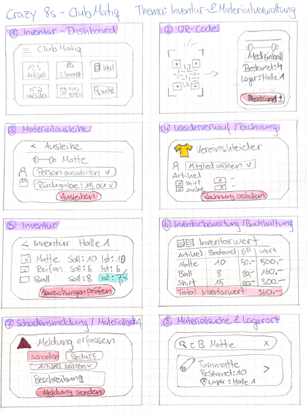
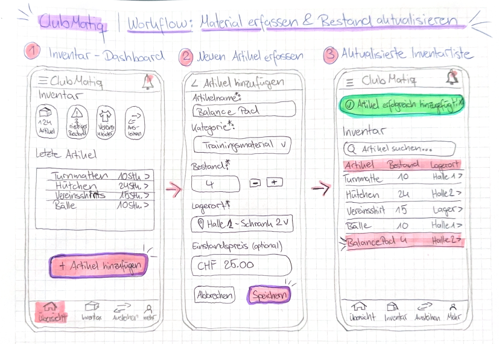

# Projektdokumentation - ClubMatiq

## Projektübersicht & Zugänge

| Angabe | Inhalt |
|---|---|
| Projekttitel | ClubMatiq – Digitale Material- und Inventarverwaltung für Vereine |
| Verfasser/in | Jennifer Mentner – **[Klasse ergänzen]** |
| GitHub-Repository | **[Direkten Link zum Repository ergänzen]** |
| Aktuelle App | Noch nicht öffentlich bereitgestellt; derzeit lokale Entwicklungsumgebung |
| Getestete Version | Lokaler Entwicklungsstand vom 11. November 2026; **[Commit/Tag nach dem Push ergänzen]** |
| Testzugänge | Registrierung und Anmeldung implementiert; separate Testzugänge für Dozierende vor der Abgabe sicher bereitstellen |
| Figma / Referenz-Mockup | **[Link ergänzen, sobald vorhanden]** |
| Weitere Artefakte [Optional] | **[Links zu Abgaben, Skizzen, User Journey Map und Projektunterlagen ergänzen]** |

> **Zugriff:** Vor der Abgabe sicherstellen, dass die Dozierenden auf Repository, App und verlinkte Artefakte zugreifen können.

> **Testzugänge:** Keine persönlichen Passwörter, API-Schlüssel oder MongoDB-Zugangsdaten im Repository veröffentlichen. Testkonten gegebenenfalls separat bereitstellen.

## Inhaltsverzeichnis

[Projektübersicht & Zugänge](#projektübersicht--zugänge)

1. [Ausgangslage](#1-ausgangslage)

2. [Lösungsidee](#2-lösungsidee)

3. [Vorgehen & Artefakte](#3-vorgehen--artefakte)

    1. [Understand & Define](#31-understand--define)

    2. [Sketch](#32-sketch)
        - [Personas](#321-personas)
        - [Crazy 8s](#322-crazy-8s)
        - [User Journey Map](#323-user-journey-map)

    3. [Decide](#33-decide)

    4. [Prototype](#34-prototype)

    5. [Validate](#35-validate)

4. [Erweiterungen [Optional]](#4-erweiterungen-optional)

5. [Projektorganisation [Optional]](#5-projektorganisation-optional)

6. [KI-Deklaration](#6-ki-deklaration)

7. [Anhang [Optional]](#7-anhang-optional)

> **Hinweis:** Massgeblich sind die im Unterricht und auf Moodle kommunizierten Anforderungen. Die Angaben zu Mindestumfang und Erweiterungen sind vor der Abgabe mit diesen Anforderungen abzugleichen.

## 1. Ausgangslage

- **Problem:** In Vereinen werden Materialbestände, Vereinskleider und Ausleihen häufig über unterschiedliche Listen und manuelle Absprachen verwaltet. Dadurch ist nicht jederzeit ersichtlich, welches Material vorhanden ist, wo es lagert und an wen es ausgeliehen wurde. Auch die Erfassung von Kleidergrössen und Inventarwerten kann aufwendig sein.

- **Ziele:** ClubMatiq soll eine zentrale, einfach bedienbare Webanwendung für Artikel, Lagerorte, Grössen und Materialbewegungen bereitstellen. Bestände sollen nachvollziehbar sein und Ausleihen sowie Rückgaben ohne parallele Listen dokumentiert werden können.

- **Primäre Zielgruppe:** Personen, die in einem Verein Material, Vereinskleider und Inventar betreuen, insbesondere Materialverantwortliche und Leiterinnen bzw. Leiter.

- **Weitere Stakeholder [Optional]:** Kassiererin bzw. Finanzverantwortliche für Inventarwerte und Rechnungsbezüge; Vereinsvorstand als organisatorisch verantwortliches Gremium. Der Turnverein Weiningen dient als Praxisbeispiel.

## 2. Lösungsidee

- **Kernfunktionalität:** ClubMatiq bündelt die Inventarverwaltung in einer Weboberfläche. Artikel werden mit Kategorie, Lagerort, Beschreibung, Bestand und Einzelwert erfasst. Vereinskleider können mehrere Grössen mit unterschiedlichen Beständen und Werten besitzen. Material kann an Personen ausgeliehen und teilweise oder vollständig zurückgegeben werden; verfügbare Mengen werden dabei automatisch angepasst. Die Übersicht zeigt offene, überfällige und abgeschlossene Ausleihen. Vereine können sich mit einem Administratorkonto registrieren und anschliessend ihre eigenen Inventardaten verwalten. Die Inventurverwaltung mit Abschluss, Korrekturen, Stornierung, Verlauf und PDF-Bericht ist inzwischen umgesetzt. QR-Codes und weitere Bereiche sind je nach Entwicklungsstand noch vorgesehen oder als Platzhalter vorhanden.

- **Annahmen [Optional]:** Eine gemeinsame Datenbasis reduziert Mehrfacherfassungen. Eine übersichtliche Bedienung mit klaren Formularen unterstützt auch Vereinsmitglieder mit wenig IT-Erfahrung. Grössenvarianten sind für die Verwaltung von Vereinskleidern notwendig.

- **Abgrenzung [Optional]:** Der aktuelle Stand ist ein lokal getesteter Prototyp und keine produktiv freigegebene Vereinssoftware. Registrierung, Anmeldung und eine erste Administratorrolle sind implementiert. Eine serverseitige Berechtigungsprüfung ist für die Inventur-Endpunkte vorhanden; die vollständige Benutzer- und Rollenverwaltung sowie sämtliche Rechteprüfungen sind vor einer Produktivfreigabe weiter zu verifizieren. Öffentliches Deployment und weitere Module sind noch nicht abgeschlossen. Eine vollständige Buchhaltung ist nicht Bestandteil des Prototyps.

## 3. Vorgehen & Artefakte

Die Entwicklung erfolgt schrittweise anhand des Vereinskontexts, der Entwurfsaufgaben aus dem Unterricht und der technischen Umsetzung eines testbaren Prototyps.

### 3.1 Understand & Define – Problemraumanalyse

#### Gewähltes Projektthema

**Digitale Inventarverwaltung für kleinere Vereine und Organisationen**

#### 1. Problemräume erkennen

Im Alltag kleinerer Vereine und Organisationen können verschiedene Herausforderungen bei der Verwaltung von Material und Inventar auftreten.

| Problemraum | Beschreibung |
|---|---|
| Fehlende Übersicht über Inventar | Es ist nicht immer klar, welche Materialien vorhanden sind, in welcher Menge und wo sie gelagert werden. |
| Unübersichtliche Materialausleihe | Ausgeliehenes Material wird teilweise nicht systematisch dokumentiert. Dadurch ist unklar, wer einen Gegenstand besitzt und wann dieser zurückgegeben werden soll. |
| Aufwendige Bestandskontrolle | Materialbestände müssen manuell überprüft und aktualisiert werden. Fehlende oder beschädigte Gegenstände werden möglicherweise erst spät entdeckt. |
| Verteilte Informationen | Informationen über Material werden in Excel-Listen, Dokumenten oder durch einzelne verantwortliche Personen verwaltet. |

**Auswahl des Problemraums:** Für das Prototyping-Projekt wird der Problemraum **«Fehlende Transparenz und hoher Verwaltungsaufwand bei der Inventarverwaltung»** ausgewählt. Er ist besonders relevant, da kleinere Organisationen häufig nur begrenzte personelle und zeitliche Ressourcen für administrative Tätigkeiten zur Verfügung haben.

#### 2. Problemraum-Analyse: Nutzer, Bedürfnisse und Kontext

| Nutzer:innen | Bedürfnisse | Kontext / Herausforderungen |
|---|---|---|
| Materialverantwortliche | Übersicht über vorhandene Artikel, Mengen und Lagerorte | Unterschiedliche Lagerorte, manuelle Bestandskontrollen, veraltete Informationen |
| Vorstandsmitglieder | Transparenz über Inventar, Materialbedarf und Anschaffungen | Fehlende zentrale Datenbasis, begrenzte Zeit, unterschiedliche Zuständigkeiten |
| Vereinsmitglieder | Schnell herausfinden, ob benötigtes Material verfügbar ist | Keine aktuelle Bestandsübersicht, Abhängigkeit von verantwortlichen Personen |
| Trainingsleitende | Benötigtes Material einfach finden und dessen Verfügbarkeit prüfen | Material wird von mehreren Personen genutzt, mögliche Überschneidungen bei der Verwendung |

#### Gesammeltes Wissen und bestehende Annahmen

Die folgenden fünf Punkte sind **erste Annahmen** über den Problemraum. Sie müssen im weiteren Projektverlauf durch Gespräche oder Beobachtungen überprüft werden:

1. **Dezentrale Inventarverwaltung:** Informationen befinden sich möglicherweise in verschiedenen Dateien oder bei einzelnen Personen, wodurch die Suche nach aktuellen Beständen erschwert werden kann.
2. **Verspätete Bestandsänderungen:** Bei Materialausgaben, Rückgaben oder Beschädigungen können Abweichungen zwischen dokumentiertem und tatsächlichem Bestand entstehen, wenn Änderungen nicht unmittelbar erfasst werden.
3. **Bedarf an einfacher Bedienung:** Ehrenamtlich tätige Personen haben häufig nur begrenzt Zeit für administrative Aufgaben. Eine komplizierte Anwendung könnte deshalb auf geringe Akzeptanz stossen.
4. **Gemeinsame Materialnutzung:** Material wird von unterschiedlichen Personen verwendet. Dadurch kann es schwierig sein, jederzeit nachzuvollziehen, wo sich bestimmte Gegenstände befinden.
5. **Risiko unnötiger Anschaffungen:** Fehlende Transparenz kann dazu führen, dass vorhandenes Material nicht gefunden und deshalb doppelt beschafft wird.

#### 3. How-Might-We-Fragen

Aus der Problemanalyse wurden drei offene Fragestellungen abgeleitet:

**HMW 1 – Transparenz (priorisiert)**

> Wie könnten wir Materialverantwortliche dabei unterstützen, jederzeit einen einfachen und aktuellen Überblick über vorhandenes Inventar, Bestände und Lagerorte zu erhalten?

**HMW 2 – Materialbewegungen**

> Wie könnten wir die Ausgabe und Rückgabe von gemeinsam genutztem Material so gestalten, dass dessen Verbleib nachvollziehbar bleibt und der administrative Aufwand möglichst gering ist?

**HMW 3 – Bestandskontrolle**

> Wie könnten wir kleinere Vereine und Organisationen dabei unterstützen, fehlendes oder knapp werdendes Material frühzeitig zu erkennen und Bestandskontrollen effizienter durchzuführen?

Die **erste Fragestellung** wurde als zentrale Leitfrage für den weiteren Prototyping-Prozess ausgewählt. Die anderen beiden Fragen werden als ergänzende Problemstellungen berücksichtigt.

#### 4. Erkenntnisse aus der bisherigen Problemanalyse

| Erkenntnis | Bedeutung für ClubMatiq |
|---|---|
| Zentrale Informationen | Relevante Informationen zur Inventarverwaltung müssen einfach auffindbar sein. |
| Aktualität | Eine Bestandsübersicht ist nur hilfreich, wenn Änderungen zuverlässig nachgeführt werden. |
| Nachvollziehbarkeit | Materialbewegungen bei gemeinsam genutzten Gegenständen müssen nachvollziehbar sein. |
| Benutzerfreundlichkeit | Auch Personen ohne vertiefte IT-Kenntnisse sollen die Anwendung verstehen. |
| Geringer Zeitaufwand | Administrative Abläufe sollen möglichst wenig zusätzliche Arbeit verursachen. |

**Einordnung:** Diese Erkenntnisse stammen aus einer ersten konzeptionellen Analyse. Sie sind **noch keine durch Nutzerinterviews bestätigten Forschungsergebnisse**. Die spätere Evaluation muss prüfen, inwiefern der Prototyp die identifizierten Bedürfnisse erfüllt.

*Quelle: Eigene Abgabe «Problemraum-Analyse», Prototyping HS2026, Seiten 1–3. Der Inhalt ist hier vollständig als README-Text und Tabellen integriert, sodass kein PDF geöffnet werden muss.*

### 3.2 Sketch

#### 3.2.1 Personas

**Drei Proto-Personas.** Für ClubMatiq wurden drei konzeptionelle Proto-Personas entwickelt. Sie beschreiben unterschiedliche Rollen, Ziele und Anforderungen im Vereinsalltag. Es handelt sich um Annahmen aus der Sketch-Phase, nicht um empirisch validierte Interviewprofile. Die vollständigen Inhalte der Personas sind nachfolgend direkt dokumentiert.

#### Jennifer (29) – Kassiererin / Vorstandsmitglied

Jennifer ist Kassiererin des Vereins, verfügt über gute IT-Kenntnisse und Erfahrung in der Buchhaltung, Rechnungsstellung und Budgetierung und legt grossen Wert auf korrekte und nachvollziehbare Finanzdaten.

**Umfeld / Kontext**

- Ehrenamtliche Tätigkeit im Vorstand
- Verwaltung der Vereinsbuchhaltung und Vorbereitung des Jahresabschlusses
- Rechnungsstellung für Vereinskleider
- Zusammenarbeit mit der Materialverantwortlichen zur Abstimmung von Verkäufen und Lagerbeständen
- Verwendung von ClubDesk für die Vereinsadministration und Buchhaltung

**Ziele**

- Aktuellen Inventarwert für die Buchhaltung ermitteln
- Vereinskleider einfach und korrekt verrechnen
- Verkäufe und offene Rechnungen nachvollziehen
- Materialbewegungen und finanzielle Auswirkungen überblicken
- Doppelte Datenerfassungen vermeiden
- Eine zuverlässige Grundlage für den Jahresabschluss erhalten

**Aufgaben**

- Rechnungen für verkaufte Vereinskleider erstellen
- Verkaufspreise und Rechnungsbeträge kontrollieren
- Zahlungseingänge überwachen
- Inventarbestände mit der Materialverantwortlichen abstimmen
- Lagerbestände und Einstandswerte für die Buchhaltung auswerten
- Einnahmen aus Kleiderverkäufen nachvollziehen
- Inventarlisten und Auswertungen für den Jahresabschluss bereitstellen

**Frustpunkte / Herausforderungen**

- Verkaufs- und Bestandsdaten müssen möglicherweise manuell abgeglichen werden
- Fehlende direkte Verbindung zwischen Materialverwaltung und Rechnungsstellung
- Inventarwerte müssen aus verschiedenen Informationen zusammengestellt werden
- Fehleranfälligkeit bei manuellen Bestandskorrekturen
- Zusätzlicher Zeitaufwand beim Jahresabschluss
- Unklare oder verspätet dokumentierte Materialbewegungen

#### Nathalie (34) – Leiterin

Nathalie ist engagierte Leiterin im Verein, organisiert und leitet regelmässig Trainings und legt Wert auf eine einfache, schnelle und unkomplizierte Nutzung digitaler Anwendungen.

**Umfeld / Kontext**

- Regelmässige Trainings in den Turnhallen
- Verwendung unterschiedlicher Sportgeräte und Trainingsmaterialien
- Material wird teilweise von mehreren Trainingsgruppen gemeinsam genutzt
- Trainingsvorbereitung findet auch ausserhalb der Turnhalle statt
- Häufig ist nur wenig Zeit für die Materialorganisation vorhanden

**Ziele**

- Schnell erkennen, welches Trainingsmaterial vorhanden ist
- Lagerorte von Geräten und Materialien einfach finden
- Verfügbarkeit von Material vor dem Training überprüfen
- Fehlendes oder beschädigtes Material unkompliziert melden
- Material für Trainings und Anlässe rechtzeitig organisieren
- Möglichst wenig Zeit mit administrativen Aufgaben verbringen

**Aufgaben**

- Trainings vorbereiten und benötigtes Material bestimmen
- Vorhandene Materialien und deren Lagerorte überprüfen
- Material für Trainings entnehmen und wieder zurückbringen
- Materialausleihen dokumentieren, sofern erforderlich
- Fehlendes oder defektes Material melden
- Materialbedarf an die zuständige Person weitergeben
- Bei Wettkämpfen oder Vereinsanlässen benötigtes Material organisieren

**Frustpunkte / Herausforderungen**

- Unklarheit darüber, ob benötigtes Material vorhanden ist
- Material befindet sich möglicherweise nicht am erwarteten Lagerort
- Keine einfache Möglichkeit, beschädigtes Material zu melden
- Rückfragen bei der Materialverantwortlichen kosten Zeit
- Überschneidungen bei der Nutzung von Material durch mehrere Gruppen
- Aufwendige oder unübersichtliche Erfassung von Materialausleihen

#### Laura (24) – Materialverantwortliche

Laura ist Materialverantwortliche des Vereins, organisiert und verwaltet das Vereinsmaterial, arbeitet strukturiert und legt grossen Wert auf eine übersichtliche, effiziente und zuverlässige Bestandsverwaltung.

**Umfeld / Kontext**

- Ehrenamtliche Verwaltung von Sportmaterial und Vereinskleidern
- Material befindet sich an unterschiedlichen Lagerorten
- Zusammenarbeit mit Leitenden, Vorstandsmitgliedern und der Kassiererin
- Material wird für Trainings, Wettkämpfe und Vereinsanlässe benötigt
- Bestände können sich durch Verkäufe, Neuanschaffungen, Ausleihen oder Beschädigungen verändern

**Ziele**

- Jederzeit eine aktuelle Übersicht über das gesamte Vereinsinventar haben
- Material nach Kategorien und Lagerorten organisieren
- Bestandsänderungen einfach erfassen
- Ausgeliehenes Material nachvollziehen können
- Fehlende oder beschädigte Artikel frühzeitig erkennen
- Mindestbestände bei Vereinskleidern überwachen
- Inventardaten für die Kassiererin bereitstellen
- Den Aufwand für Inventuren reduzieren

**Aufgaben**

- Neue Materialien und Vereinskleider erfassen
- Artikelinformationen und Lagerorte pflegen
- Materialeingänge und Materialausgaben dokumentieren
- Bestände nach Kleiderverkäufen aktualisieren
- Ausleihen und Rückgaben verwalten
- Beschädigtes oder verlorenes Material erfassen
- Regelmässige Inventuren durchführen
- Fehlende Artikel und Nachbestellungen koordinieren
- Aktuelle Bestandsinformationen an den Vorstand weitergeben
- Inventarwerte gemeinsam mit der Kassiererin überprüfen

**Frustpunkte / Herausforderungen**

- Manuelle Aktualisierung verschiedener Bestandslisten
- Fehlende Transparenz über ausgeliehenes Material
- Unterschiedliche oder unvollständige Angaben zu Lagerorten
- Bestandsabweichungen nach Materialausgaben oder Verkäufen
- Zeitaufwendige Inventuren
- Schwierige Nachverfolgung von Materialbewegungen
- Fehlende automatische Hinweise bei niedrigen Beständen

#### Vergleich der drei Proto-Personas

| Bereich | Jennifer | Nathalie | Laura |
|---|---|---|---|
| Inventarübersicht | Relevant | Relevant | Sehr wichtig |
| Material suchen | Gelegentlich | Sehr wichtig | Sehr wichtig |
| Bestände bearbeiten | Eingeschränkt | Meldungen | Sehr wichtig |
| Ausleihen verwalten | Übersicht | Ausleihen/Rückgaben | Verwaltung |
| Vereinskleider verkaufen | Rechnungsstellung | – | Bestandsführung |
| Rechnungen erstellen | Sehr wichtig | – | – |
| Inventarbewertung | Sehr wichtig | – | Daten bereitstellen |
| Inventur durchführen | Auswertung | – | Sehr wichtig |
| Materialbedarf melden | – | Sehr wichtig | Bearbeitung |

*Quelle: Eigene Abgabe «Sketch / Skizzieren», Seiten 1–3. Die Personas und der Vergleich sind hier vollständig als README-Text integriert.*

#### 3.2.2 Crazy 8s

Aus den Bedürfnissen der drei Proto-Personas wurden acht Lösungsansätze entwickelt und handschriftlich skizziert.

| Nr. | Lösungsansatz | Beschreibung | Relevante Personas |
|---|---|---|---|
| 1 | Zentrales Inventar-Dashboard | Übersicht über Materialien, Bestand, Lagerort und Status inklusive Warnhinweisen. | Laura, Jennifer, Nathalie |
| 2 | Materialverwaltung per QR-Code | Artikelinformationen und Bestandsänderungen per QR-Code aufrufen bzw. erfassen. | Laura, Nathalie |
| 3 | Digitale Materialausleihe | Material Personen zuordnen, Rückgabedaten festhalten und offene Ausleihen anzeigen. | Laura, Nathalie |
| 4 | Vereinskleider mit Rechnungsstellung | Kleiderverkäufe erfassen, Bestand anpassen und Rechnung vorbereiten. | Jennifer, Laura |
| 5 | Digitale Inventur | Soll- und Ist-Bestände vergleichen und Abweichungen korrigieren. | Jennifer, Laura |
| 6 | Inventarbewertung für die Buchhaltung | Bestände und Einstandspreise zu einem Inventarwert zusammenführen. | Jennifer, Laura |
| 7 | Materialbedarf und Schadensmeldungen | Fehlendes oder beschädigtes Material melden und bearbeiten. | Nathalie, Laura |
| 8 | Materialsuche nach Lagerort | Material nach Kategorien, Suchbegriffen und Lagerorten finden. | Nathalie, Laura |



*Abbildung 4: Acht Ideen mit handgezeichneten Skizzen aus der Sketch-Abgabe.*

**Primärnachweis:** [Abgabe 9 – Sketch / Skizzieren (PDF)](docs/artefakte/skizzieren.pdf), Seiten 1–4.

#### 3.2.3 User Journey Map

Die User Journey zeigt den Ablauf der **Artikelerfassung aus Sicht von Laura**, der Materialverantwortlichen. Sie umfasst vier Phasen: Dashboard öffnen, Artikel erfassen, Angaben prüfen und Speichern. Dabei werden Ziele, Aktionen, Touchpoints, Emotionen, mögliche Probleme und Verbesserungsmassnahmen betrachtet.

| Phase | Aktion | Mögliche Herausforderung | Gestaltungsmassnahme |
|---|---|---|---|
| Dashboard öffnen | Laura navigiert zur Artikelerfassung. | Die passende Funktion ist schwer zu finden. | Klare Navigation und gut sichtbare Aktion. |
| Artikel erfassen | Laura trägt die Angaben zum neuen Material ein. | Pflichtangaben sind unklar. | Verständliche Feldbezeichnungen und Pflichtfeldkennzeichnung. |
| Angaben prüfen | Laura kontrolliert die eingegebenen Daten. | Falsche Mengen oder unvollständige Daten. | Plausibilitätsprüfung und verständliche Hinweise. |
| Speichern | Laura schliesst die Erfassung ab. | Unklar, ob der Artikel gespeichert wurde. | Eindeutige Erfolgs- oder Fehlermeldung. |



*Abbildung 5: User Journey Map und handgezeichneter Ablauf der Artikelerfassung.*

**Hinweis:** Die User Journey behandelt die **Artikelerfassung**, nicht die Materialausleihe. Die handgezeichneten Ansichten sind Konzeptskizzen und keine Screenshots der fertigen Anwendung.

**Primärnachweis:** [Abgabe 9 – Sketch / Skizzieren (PDF)](docs/artefakte/skizzieren.pdf), Seiten 5–6.

### 3.3 Decide

**Entscheidung.** Ausgewählt wurde das **zentrale Inventar-Dashboard**. Gemäss Entscheidungsreflexion berücksichtigt es die Bedürfnisse aller drei Proto-Personas, vereinfacht die Artikelsuche und bildet eine erweiterbare Grundlage für Ausleihe, Rechnungsstellung und Inventarbewertung. Damit passt die Wahl zur priorisierten HMW-Frage nach Transparenz über Bestände und Lagerorte.

### 3.4 Prototype

#### 3.4.1. Entwurf (Design)

- **Informationsarchitektur:** Die Startseite bietet Zugänge zu Inventar, QR-Code, Materialausleihe, Vereinskleidern, Inventur, Inventarbewertung, Schadensmeldungen und Materialsuche. Registrierung und Anmeldung sind als eigene Seiten umgesetzt; der Kopfbereich zeigt bei angemeldeten Benutzern Name, Rolle und Abmeldefunktion. Über die Navigation ist ausserdem die Stammdatenverwaltung mit Kategorien, Lagerorten und Grössen erreichbar. Einzelne noch nicht implementierte Bereiche dienen weiterhin als Platzhalter.

- **User Interface Design:** Die Inventarübersicht kombiniert Kennzahlen, Suche, Kategorienfilter und eine Artikeltabelle. Artikel können aufgeklappt, bearbeitet und gelöscht werden. Das Ausleihformular zeigt verfügbare Mengen; die Ausleihübersicht enthält Statusfilter, Kennzahlen und einen Rückgabedialog. **[Screenshots der Startseite, Inventarübersicht, Artikelmaske und Materialausleihe ergänzen]**.

- **Designentscheidungen:** Wiederkehrende Formulare, eindeutige Schaltflächen und eine konsistente Farbgestaltung sollen die Bedienung vereinfachen. Vereinskleider werden nicht als separate Artikelwelt geführt, sondern über Grössenvarianten innerhalb der zentralen Inventarverwaltung abgebildet.

#### 3.4.2. Umsetzung (Technik)

- **Technologie-Stack:** SvelteKit, Svelte 5, TypeScript, MongoDB-Treiber für Node.js und MongoDB Atlas als Cloud-Datenbank.

- **Tooling:** Visual Studio Code, Node.js/npm, Git, GitHub, MongoDB Atlas und lokale Browser-Tests. KI-Unterstützung ist in Kapitel 6 beschrieben.

- **Vorgehen bei der Implementierung:** Funktionen wurden in kleinen Schritten umgesetzt und unmittelbar lokal geprüft: zunächst Projektstruktur und Datenbankverbindung, danach Stammdaten, Artikelanlage, Inventarübersicht, Artikelbearbeitung, Materialausleihe mit Rückgabe und anschliessend die Inventurverwaltung samt PDF-Export. Fehlermeldungen aus TypeScript und Laufzeittests wurden schrittweise behoben. Danach wurden Registrierung, Login, Session-Prüfung, automatische Anmeldung nach Registrierung und die Vereinsfilter in den API-Endpunkten ergänzt. Die Umsetzung wurde durch ChatGPT mit Codevorschlägen und Fehlersuche unterstützt; Auswahl, Integration und lokale Prüfung erfolgten im Projekt. Details siehe Kapitel 6.

- **Struktur & Komponenten:** Die Seiten liegen unter `src/routes/`, beispielsweise `inventar/`, `inventar/neu/`, `inventar/[id]/bearbeiten/`, `ausleihen/`, `stammdaten/`, `anmelden/` und `registrieren/`. Die Komponente `src/lib/AusleihenUebersicht.svelte` stellt die Ausleihen dar und ermöglicht Rückgaben. Die MongoDB-Verbindung befindet sich in `src/lib/server/mongodb.ts`. Server-Endpunkte liegen unter `src/routes/api/`.

- **Daten & Schnittstellen:** Die Datenbank `clubmatiq` enthält unter anderem die Collections `artikel`, `artikelvarianten`, `kategorien`, `lagerorte`, `groessen`, `ausleihen`, `vereine`, `benutzer` und `sessions`. SvelteKit-API-Routen stellen JSON-Daten bereit und übernehmen Prüfungen und Schreiboperationen. Für Ausleihen, Rückgaben und kritische Inventurvorgänge werden MongoDB-Transaktionen eingesetzt, damit Bestandsänderungen und Ausleihvorgänge gemeinsam gespeichert werden. Verbindungsdaten werden über eine lokale `.env`-Datei verwaltet und nicht ins Repository übernommen. Passwörter werden mit Argon2 gehasht; Sessions werden über ein HttpOnly-Cookie und serverseitig gespeicherte Token-Hashes verwaltet. Der Server-Hook `src/hooks.server.ts` prüft die Anmeldung und schützt nicht öffentliche Routen. Die Datensätze der Inventar-Collections tragen eine `vereinId`; API-Abfragen und Schreiboperationen sind auf den angemeldeten Verein eingeschränkt. Für ältere Datensätze wurde ein Migrationsskript zur Vereinszuordnung ausgeführt.

- **Deployment:** Link siehe «Aktuelle App» in der [Projektübersicht](#projektübersicht--zugänge). Ein öffentliches Deployment ist noch ausstehend; Netlify ist als Hosting-Option vorgesehen.

- **Besondere Entscheidungen:** Grössenabhängige Artikel erhalten eigene Datensätze in `artikelvarianten`, damit Mengen und Einzelwerte pro Grösse unterschiedlich sein können. Bei einer Ausleihe wird derzeit der **verfügbare** Bestand reduziert und bei Rückgabe erhöht. Für eine spätere buchhalterische Inventarbewertung muss weiterhin ausgeliehenes, aber vereinseigenes Material mitgezählt werden. Die grundlegende Authentifizierung ist umgesetzt. Vor einer öffentlichen Freigabe müssen insbesondere Rollenrechte, alle API-Endpunkte, parallele Änderungen, Registrierungs-Missbrauchsschutz, PDF-Zugriff und Mandantentrennung sicherheitstechnisch weiter geprüft werden.

### 3.5 Validate

> **Stand 11. November 2026:** Bisher wurden Funktionen während der Entwicklung lokal ausprobiert. Eine formelle, separat deployte Nutzerevaluation mit dokumentierter Stichprobe und Nachweisen ist noch nicht abgeschlossen. Inventur- und PDF-Funktionen wurden lokal mit `npm run check` und manuellen Browser-Tests überprüft. Die folgenden Angaben sind deshalb als Planungsstand gekennzeichnet.

- **Getestete Version:** Bislang lokaler Entwicklungsstand; separat deployte Testversion und Commit/Tag noch ausstehend. Link nach Bereitstellung in der [Projektübersicht](#projektübersicht--zugänge) ergänzen.

- **Ziele der Prüfung:** Können Vereinsverantwortliche Artikel selbstständig erfassen und finden? Sind Grössenbestände verständlich? Lassen sich Ausleihen und Teilrückgaben fehlerfrei durchführen?

- **Vorgehen:** **[Formelle Evaluation noch planen: moderiert/unmoderiert, vor Ort/remote]**. Bisher erfolgten manuelle Funktionstests während der Entwicklung.

- **Stichprobe:** **[Testpersonen, Rollen und Anzahl nach tatsächlicher Durchführung ergänzen]**.

- **Aufgaben/Szenarien:** Vorgeschlagene Szenarien: (1) Neuen Inventarartikel mit Lagerort erfassen; (2) Vereinskleid mit mehreren Grössen und Preisen erfassen; (3) Artikel über Suche finden; (4) Material ausleihen; (5) Teilrückgabe und anschliessend vollständige Rückgabe erfassen.

- **Kennzahlen & Beobachtungen:** **[Erfolgsquote, Zeitbedarf, Schwierigkeiten und Rückmeldungen erst nach Durchführung eintragen]**. In lokalen Entwicklungstests funktionierten Artikelanlage, Bearbeitung, Löschung sowie Ausleihe und Rückgabe nach Fehlerkorrekturen. Zusätzlich wurden die automatische Anmeldung nach Neuregistrierung sowie die Trennung von Inventardaten und Testkategorien zwischen zwei Vereinen manuell erfolgreich überprüft.

- **Nachweise:** **[Anonymisierte Testprotokolle, Screenshots, Beobachtungsnotizen und Auswertung verlinken]**.

- **Zusammenfassung der Resultate:** Die bisherigen lokalen Tests bestätigen die grundlegende technische Funktionsfähigkeit der umgesetzten Kernabläufe. Bei einem zweiten Testverein waren die Daten des ersten Vereins nicht sichtbar; auch eine neu erstellte Testkategorie blieb auf den eigenen Verein beschränkt. Dies ist ein Funktionstest, kein vollständiger Sicherheitsnachweis gegen manipulierte API-Anfragen. Aussagen über die Verständlichkeit und Nutzbarkeit für andere Vereinsmitglieder sind erst nach einer strukturierten Evaluation möglich.

- **Abgeleitete Verbesserungen:** Als nächste Schritte sind eine vollständige Prüfung der Mandantentrennung bei direkten API-Anfragen, die Verifikation aller Benutzer- und Rollenrechte, QR-Code-Zugriff auf Artikel sowie weitere Module vorgesehen. Konkrete, aus Nutzertests abgeleitete Verbesserungen werden nach der Evaluation ergänzt.

## 4. Erweiterungen [Optional]

> **Wichtig:** Die nachfolgenden Funktionen sind als **mögliche** Software-Erweiterungen dokumentiert. Ob sie tatsächlich über den verbindlichen Mindestumfang hinausgehen und als Erweiterung zählen, muss anhand der Moodle-/Unterrichtsanforderungen geprüft werden. Für eine Bewertung sind Nachweise und Codereferenzen zu ergänzen.

### 4.1 Software-Erweiterungen

#### 4.1.1 Grössenabhängige Inventarvarianten

- **Beschreibung & Nutzen:** Vereinskleider können mit mehreren Grössen und jeweils eigenem Bestand sowie Einzelwert verwaltet werden. Dies erleichtert die Bestandsführung für Kinder- und Erwachsenengrössen.

- **Abgrenzung zum Mindestumfang:** **[Prüfen und konkret mit den verbindlichen Mindestanforderungen abgleichen]**.

- **Umsetzung:** Datenmodell mit `artikel` und `artikelvarianten`; Artikelanlage und -bearbeitung mit Grössentabelle sowie Summenberechnung in der Inventarübersicht.

- **Nachweise:** **[Screenshot der Grössentabelle ergänzen]**. Codestellen: `src/routes/inventar/neu/+page.svelte`, `src/routes/inventar/[id]/bearbeiten/+page.svelte`, `src/routes/api/artikel/+server.ts`, `src/routes/api/inventar-uebersicht/+server.ts`.

- **Bezug zur Evaluation:** Nein; aus dem Vereinskontext und den Anforderungen an die Kleiderverwaltung abgeleitet.

#### 4.1.2 Teil- und Vollrückgabe bei Materialausleihen

- **Beschreibung & Nutzen:** Material kann in mehreren Schritten zurückgegeben werden. Der verfügbare Bestand erhöht sich jeweils um die tatsächlich zurückgegebene Menge; abgeschlossene Ausleihen bleiben nachvollziehbar.

- **Abgrenzung zum Mindestumfang:** **[Prüfen und konkret mit den verbindlichen Mindestanforderungen abgleichen]**.

- **Umsetzung:** Rückgabe-Endpunkt mit MongoDB-Transaktion und Rückgabedialog in der Ausleihübersicht. Status und Restmenge werden aktualisiert.

- **Nachweise:** **[Screenshot einer Teilrückgabe und der aktualisierten Übersicht ergänzen]**. Codestellen: `src/routes/api/ausleihen/[id]/rueckgabe/+server.ts` und `src/lib/AusleihenUebersicht.svelte`.

- **Bezug zur Evaluation:** Nein; als funktionale Ergänzung des Ausleihprozesses umgesetzt. Eine spätere Nutzerevaluation steht noch aus.

### 4.2 Weitere Erweiterungen

#### 4.2.1 Vereinsregistrierung, Anmeldung und Mandantentrennung

- **Beschreibung & Nutzen:** Mehrere Vereine können die gleiche Anwendung mit getrennten Datenbeständen nutzen. Bei der Registrierung werden ein Verein und ein Administratorkonto angelegt; nach erfolgreicher Registrierung erfolgt die automatische Anmeldung.

- **Abgrenzung zum Mindestumfang:** **[Mit verbindlichen Anforderungen aus Moodle abgleichen]**.

- **Umsetzung:** `vereine`, `benutzer` und `sessions` in MongoDB; Passwort-Hashing mit Argon2; Session-Cookie und Authentifizierungsprüfung in `src/hooks.server.ts`; serverseitige Weitergabe des Benutzers über `src/routes/+layout.server.ts`. Die relevanten Inventar-APIs filtern nach `vereinId`, darunter Artikel, Kategorien, Lagerorte, Grössen, Ausleihen und Inventarübersicht. Registrierungsseite unter `src/routes/registrieren/+page.svelte`.

- **Nachweise:** **[Screenshots der Registrierung, angemeldeten Startseite und des Tests mit zwei Vereinen ergänzen]**.

- **Bezug zur Evaluation:** Zwei Vereine wurden im lokalen Entwicklungstest auf getrennte Anzeige und Erstellung von Daten geprüft; ein systematischer Sicherheits- und Nutzertest steht aus.

Noch keine zusätzliche methodische oder organisatorische Erweiterung zur Bewertung dokumentiert. **[Bei Bedarf einen Eintrag 4.2.1 mit sämtlichen Pflichtfeldern gemäss Vorlage ergänzen]**.

## 5. Projektorganisation [Optional]

- **Repository & Struktur:** Die Projektdateien werden in einem GitHub-Repository verwaltet; Link siehe [Projektübersicht](#projektübersicht--zugänge). SvelteKit trennt Seiten, wiederverwendbare Komponenten, serverseitige Datenbankanbindung und API-Endpunkte.

- **Issue-Management:** **[Falls verwendet: Vorgehen und Link ergänzen; andernfalls «Kein separates Issue-Management dokumentiert»]**.

- **Commit-Praxis:** Änderungen werden mit Git versioniert und auf GitHub gesichert. Sprechende Commit-Nachrichten sollen den jeweiligen Entwicklungsstand erkennbar machen.

## 6. KI-Deklaration

KI wurde im Projekt eingesetzt, insbesondere bei der Programmierung und technischen Fehlersuche. Die Nutzung wird nachfolgend offengelegt.

### 6.1 KI-Tools

- **Eingesetzte Tools:** ChatGPT (OpenAI); **[weitere tatsächlich eingesetzte KI-Tools und gegebenenfalls Modellvarianten ergänzen]**.

- **Zweck & Umfang:** ChatGPT wurde zur Strukturierung von Entwicklungsschritten, zum Formulieren von Codevorschlägen für SvelteKit-Komponenten und API-Endpunkte, zur Erklärung von TypeScript-Fehlern, zur Fehlerbehebung und zur Überarbeitung der Projektdokumentation verwendet. Wesentliche Teile der bisher implementierten Funktionen basieren auf KI-unterstützten Codevorschlägen.

- **Eigene Leistung (Abgrenzung):** Projektidee und Vereinsanforderungen wurden aus dem eigenen Anwendungskontext eingebracht. Die vorgeschlagenen Änderungen wurden eigenständig in VS Code integriert, lokal ausgeführt, auf Fehler geprüft und bei Bedarf gemeinsam mit der KI überarbeitet. **[Weitere selbst erstellte Entwurfs- und Analyseartefakte konkret ergänzen]**.

### 6.2 Vorgehen mit KI

- **Arbeitsablauf & Aufgabenverteilung:** Die Entwicklung wurde in kleine, einzeln überprüfbare Schritte gegliedert. ChatGPT lieferte Erklärungen und teilweise vollständige Dateivorschläge. Die Umsetzung in der lokalen Entwicklungsumgebung, das Ausführen der Tests und die Rückmeldung zu auftretenden Fehlern erfolgten durch die Projektbearbeiterin. Es wurde keine eigenständig im Repository handelnde Coding-Agent-Umgebung eingesetzt, soweit bisher dokumentiert.

- **Prompt-Vorgehen & Kontext:** Anforderungen wurden anhand konkreter Vereinsprozesse beschrieben. Für Fehlerbehebungen wurden Fehlermeldungen und bestehende Codeausschnitte bereitgestellt. Nach jedem Entwicklungsschritt wurde geprüft, ob die Funktion wie vorgesehen arbeitet.

- **Konfiguration & Werkzeuge:** Keine projektspezifische KI-Agenten-Konfiguration dokumentiert. Die Codeintegration erfolgte in Visual Studio Code; Git/GitHub dienten der Versionsverwaltung. Die Anmeldung und Mandantentrennung wurden anhand vorhandener API-Dateien und lokaler Tests schrittweise überarbeitet.

- **Prüfung & Überarbeitung:** KI-Vorschläge wurden durch lokale Ausführung, Browser-Tests und TypeScript-Fehlermeldungen überprüft. Bei Problemen wurden die betroffenen Stellen angepasst und erneut getestet. So wurde die automatische Anmeldung nach der Registrierung erst nach Anpassung der Registrierungsseite und der Navigation korrekt angezeigt. Für eine spätere Veröffentlichung sind zusätzliche Sicherheits-, Integrations- und Nutzertests erforderlich. Externe Inhalte und Lizenzen sind vor der Abgabe gesondert zu prüfen.

### 6.3 Reflexion

Der Einsatz von ChatGPT hat die schrittweise technische Umsetzung beschleunigt und insbesondere bei der Fehlersuche geholfen. Gleichzeitig zeigte sich, dass generierter Code nicht automatisch fehlerfrei oder direkt mit bestehenden Dateien kompatibel ist: Unter anderem mussten TypeScript-Typen und die Reihenfolge von Variablendeklarationen korrigiert werden. Die Verantwortung für das Verständnis, die Integration, die Prüfung und die abschliessende Qualität der Anwendung verbleibt bei der Projektbearbeiterin. Für die weitere Entwicklung sind nachvollziehbare Tests und eine kritische Prüfung sicherheitsrelevanter Funktionen wichtig.

## 7. Anhang [Optional]

- **Quellen:** **[Verwendete fremde Vorlagen, Bilder, Icons, Code und weitere Inhalte mit Quelle sowie Lizenz/Nutzungsbedingungen ergänzen]**. Die Dokumentationsstruktur basiert auf der im Unterricht bereitgestellten README-Vorlage.

- **Testskript & Materialien:** **[Link zu den Testaufgaben und anonymisierten Testprotokollen ergänzen]**.

- **Rohdaten/Auswertung:** **[Falls vorhanden: Link ergänzen]**.

- **Entwurfsartefakte:** Problemraumanalyse (vollständig in Kapitel 3.1) und [Sketch-Abgabe](docs/artefakte/skizzieren.pdf); Mockup-Link bei Vorliegen ergänzen.

**---**

**Dokumentationsstand:** 11. November 2026 – Designartefakte aus Abgabe 1 und Abgabe 9 integriert; laufender Prototyp, noch keine abschliessende Evaluation.


## 8. Inventurverwaltung – technischer Funktionsstand

**Stand: 11. November 2026.** Die nachfolgenden Funktionen wurden im Projekt schrittweise ergänzt und lokal geprüft. Die Dokumentation beschreibt den bekannten Implementierungsstand, keine produktive Sicherheitszertifizierung.

### 8.1 Inventur anlegen, zählen und verwalten

- Inventurtypen: Gesamtinventur oder Inventur für einen bestimmten Lagerort.
- Inventurpositionen enthalten Artikel, optionale Grösse, Soll-Bestand, Ist-Bestand, Differenz und Bemerkung.
- Suche und Filter nach offenen, gezählten oder abweichenden Positionen; Fortschrittsanzeige und Kennzahlen.
- Ist-Mengen werden positionsweise gespeichert; Eingaben müssen ganze Zahlen ab null sein oder für eine noch offene Zählung `null`.
- Offene Zählungen können zurückgesetzt werden, ohne die eigentlichen Lagerbestände zu verändern.
- Abschluss erst, wenn alle Positionen gezählt und gespeichert sind. Bestandsdifferenzen werden bei Abschluss ins Inventar übernommen.

### 8.2 Abschluss, Korrekturen und Stornierung

- **Abschluss:** Verbindliche Übernahme der Differenzen, Statuswechsel auf `abgeschlossen`, Protokollierung des Vorgangs.
- **Nachträgliche Korrektur:** Bei abgeschlossenen Inventuren kann eine gezählte Menge mit Begründung korrigiert werden. Nur die zusätzliche Bestandsdifferenz wird gebucht; ursprüngliche Werte bleiben über das Protokoll nachvollziehbar.
- **Stornierung:** Offene oder abgeschlossene Inventuren können mit Begründung storniert werden. Bei abgeschlossenen Inventuren werden die durch die Inventur gebuchten Differenzen unter den serverseitigen Sicherheitsprüfungen rückgebucht. Spätere unabhängige Ausleihen und Rückgaben sollen bestehen bleiben.
- **Schutz vor konkurrierenden Änderungen:** Inventuren führen eine `version`. Vor kritischen Aktionen werden Status und Version erneut geprüft; Transaktionen halten zusammengehörige Datenbankänderungen konsistent.
- **Protokollierung:** In `inventurprotokoll` werden insbesondere Abschlüsse, nachträgliche Korrekturen und Stornierungen mit Zeitstempel und Benutzerreferenz dokumentiert. Für ältere Inventuren können einzelne historische Angaben fehlen.

### 8.3 Inventurverlauf und Korrekturhistorie

Die Detailseite zeigt einen chronologischen **Inventurverlauf** (unter anderem Erstellung, Abschluss, Korrektur, Stornierung) sowie eine separate Tabelle **Nachträgliche Korrekturen**. Die Historie enthält Artikel/Grösse, vorherige und neue Menge, Buchungsdifferenz, Begründung, Zeitpunkt und – soweit auflösbar – den Namen der bearbeitenden Person. Die ursprünglichen Abschlusszählungen sind im Verlauf einsehbar. Historie und Verlauf können aktualisiert werden.

### 8.4 Inventurbericht als PDF

- Bibliothek: `pdf-lib` (über npm installiert).
- Serverroute: `GET /api/inventuren/[id]/pdf`.
- Zugriff aus der Inventurdetailseite über **«Inventurbericht als PDF herunterladen»**.
- Bericht mit Inventurinformationen, Positionen und Soll-/Ist-/Differenzvergleich sowie Informationen zu Abschluss, nachträglichen Korrekturen und gegebenenfalls Stornierung.
- Die Unterscheidung zwischen ursprünglichem Abschlussbestand und späteren Korrekturen ist für die Nachvollziehbarkeit wesentlich.
- **Bekannte Einschränkung:** Im ersten PDF-Stand können Grössen als IDs statt als lesbare Bezeichnungen erscheinen. Dies sollte vor der Abgabe verbessert und mit verschiedenen Inventurtypen getestet werden.

### 8.5 Wichtige Dateien und API-Routen

| Datei / Route | Aufgabe |
|---|---|
| `src/routes/inventur/[id]/+page.svelte` | Detailansicht, Zählung, Abschluss, Korrektur, Stornierung, Verlauf und PDF-Button |
| `src/routes/api/inventuren/[id]/+server.ts` | `GET` Inventur und Positionen; `PATCH` einzelne Zählposition speichern |
| `src/routes/api/inventuren/[id]/abschliessen/+server.ts` | Inventur abschliessen und Bestandsdifferenzen übernehmen |
| `src/routes/api/inventuren/[id]/zuruecksetzen/+server.ts` | Zählung einer offenen Inventur zurücksetzen |
| `src/routes/api/inventuren/[id]/korrigieren/+server.ts` | Nachträgliche Bestandskorrektur mit Begründung |
| `src/routes/api/inventuren/[id]/stornieren/+server.ts` | Inventur stornieren, gegebenenfalls Rückbuchungen |
| `src/routes/api/inventuren/[id]/korrekturhistorie/+server.ts` | Korrekturhistorie und chronologischen Verlauf liefern |
| `src/routes/api/inventuren/[id]/pdf/+server.ts` | PDF-Bericht aus MongoDB-Daten erstellen |
| `src/lib/server/mongodb.ts` | MongoDB-Verbindung und Client für Transaktionen |
| `src/lib/server/berechtigungen.ts` | Zentrale Berechtigungsprüfung |

Die Route für den PDF-Bericht wird separat von der bestehenden Inventur-`GET`/`PATCH`-API geführt. Dadurch muss der bereits funktionierende Datenabruf nicht für die PDF-Ausgabe umgebaut werden.

### 8.6 Relevante Datenbank-Collections

| Collection | Zweck |
|---|---|
| `inventuren` | Inventurkopf mit Name, Typ, Lagerort, Status, Version und Zeitstempeln |
| `inventurpositionen` | Einzelne Zählpositionen mit Soll-/Ist-Bestand, Bemerkungen und Artikelbezug |
| `inventurprotokoll` | Historische Aktionen und nachträgliche Korrekturen |
| `artikel`, `artikelvarianten` | Tatsächliche Artikelbestände und grössenabhängige Bestände |
| `groessen`, `lagerorte`, `kategorien` | Stammdaten |
| `vereine`, `benutzer`, `sessions` | Mandantentrennung, Benutzer und Anmeldung |
| `ausleihen` | Ausleihen und Rückgaben |

**Mandantentrennung:** Inventurdaten werden mit der `vereinId` des angemeldeten Benutzers abgefragt und verändert. Der API-Zugriff muss zusätzlich anhand der erforderlichen Berechtigung geprüft werden (z. B. `inventur:lesen`, `inventur:zaehlen`, `inventur:abschliessen`). Die vollständige Rechteabdeckung aller Endpunkte ist weiterhin zu testen.

## 9. Lokale Installation und Tests

### 9.1 Voraussetzungen

- Node.js und npm
- Zugriff auf die konfigurierte MongoDB-Instanz
- Lokale Umgebungsvariablen in `.env` gemäss Projektkonfiguration; **niemals Zugangsdaten ins Git-Repository übernehmen**

```bash
npm install
npm run dev
```

Die lokale Anwendung ist üblicherweise unter `http://localhost:5173` erreichbar, sofern Vite keinen anderen Port meldet.

### 9.2 Qualitätskontrolle

```bash
npm run check
```

`npm run check` führt SvelteKit-Synchronisierung und TypeScript-/Svelte-Prüfungen aus. Ein fehlerfreier Check ersetzt **keine** funktionalen, Berechtigungs- oder Integrationstests.

### 9.3 Manuelle Inventur-Testfälle

1. Gesamtinventur und Lagerortinventur anlegen; Soll-Bestände prüfen.
2. Zählpositionen speichern, Filter und Fortschrittsanzeige prüfen.
3. Abschluss bei offenen oder ungespeicherten Positionen blockieren; vollständig gezählte Inventur abschliessen.
4. Ursprüngliche Soll-/Ist-Werte und Bestandsbuchungen nach Abschluss kontrollieren.
5. Nachträgliche Korrektur mit Begründung buchen; zusätzliche Differenz und Historie prüfen.
6. Inventurverlauf öffnen, Benutzername und Abschlussdetails kontrollieren.
7. Offene und abgeschlossene Inventur stornieren; Rückbuchung und Protokoll prüfen.
8. PDF über den Button herunterladen; Inhalte mit Inventurpositionen und Verlauf vergleichen.
9. Negative Bestände, veraltete Versionen, ungültige Mengen und fehlende Berechtigungen gezielt testen.
10. Zugriffe zwischen zwei Vereinen sowie manipulierte Inventur-IDs auf Datenisolation prüfen.

**Bisher bestätigte lokale Prüfungen:** `npm run check` nach dem PDF-Endpunkt ohne Fehler; PDF-Download über die direkte API-URL und über den Button erfolgreich ausprobiert. Weitere Testfälle sind als Testplan zu verstehen und nicht automatisch als bereits bestanden.

## 10. Technische Entscheidungen und offene Punkte

### 10.1 Entscheidungen

- **SvelteKit + TypeScript:** Gemeinsames Projekt für Weboberfläche und serverseitige API.
- **MongoDB mit Vereinsfilter:** Daten werden mandantenbezogen über `vereinId` verarbeitet.
- **Transaktionen:** Bestandsänderungen und Protokolleinträge sollen gemeinsam erfolgreich sein oder gemeinsam fehlschlagen.
- **Versionierung:** Reduziert das Risiko, dass parallele Bearbeitungen unbemerkt überschrieben werden.
- **Historisches Protokoll:** Änderungen bleiben nachvollziehbar, statt ausschliesslich den aktuellen Bestand zu zeigen.
- **Serverseitiges PDF:** Einheitliche Berichtserstellung aus den gespeicherten Daten ohne clientseitige Bestandsberechnung.
- **Schrittweise Entwicklung:** Eine Datei beziehungsweise Funktion pro Änderung, anschliessend `npm run check` und Browser-Test.

### 10.2 Offene Aufgaben vor der Abgabe / Produktivsetzung

- [ ] Repository-Link, Klasse, Testzugänge und Entwurfsartefakte in Kapitel «Projektübersicht» ergänzen.
- [ ] Screenshots der tatsächlichen Oberfläche, Crazy-8s, Entscheidungsreflexion, User Journey und Mockup verlinken.
- [ ] Verbindliche Moodle-Anforderungen mit dokumentierten Erweiterungen abgleichen.
- [ ] Strukturierte Nutzerevaluation durchführen und Ergebnisse nachvollziehbar dokumentieren.
- [ ] PDF-Grössenbezeichnungen verbessern und Berichte mit Korrekturen/Stornierungen gegenprüfen.
- [ ] Sämtliche Berechtigungen und die Mandantentrennung mit negativen API-Tests überprüfen.
- [ ] Grenzfälle bei Transaktionen, konkurrierenden Änderungen und Rückbuchungen testen.
- [ ] Öffentliche Bereitstellung, Datenschutz, Sicherung/Wiederherstellung und Betriebsprozesse klären.
- [ ] Weitere geplante Module nur dann als implementiert kennzeichnen, wenn sie tatsächlich funktionieren.

### 10.3 Entwicklungsstand / Änderungsprotokoll

| Datum | Änderung | Status |
|---|---|---|
| Bis 10.11.2026 | Stammdaten, Artikelverwaltung, Ausleihen/Rückgaben, Anmeldung und Vereinszuordnung | Lokal entwickelt und teilweise manuell getestet |
| 11.11.2026 | Inventurabschluss, nachträgliche Korrektur, Stornierung, Protokoll und Inventurverlauf dokumentiert | Lokal umgesetzt und geprüft |
| 11.11.2026 | Inventur-PDF über `pdf-lib` und Download-Button | `npm run check` und Download lokal erfolgreich getestet |

> **Dokumentationsregel:** Nach jedem weiteren Entwicklungsschritt die betroffenen Funktionen, API-Routen, bekannten Einschränkungen und Testresultate hier nachführen. Nicht getestete Funktionen ausdrücklich als offen markieren.
