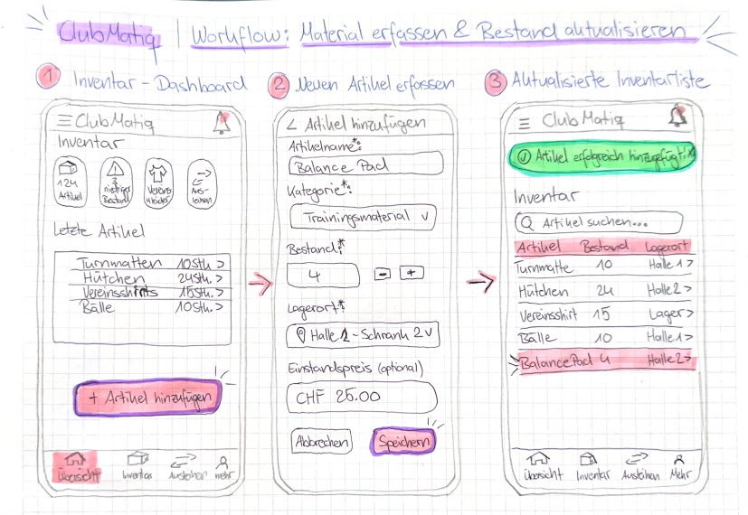

# Projektdokumentation - ClubMatiq

## Projektübersicht & Zugänge

| Angabe | Inhalt |
|---|---|
| Projekttitel | ClubMatiq – Digitale Material-, Inventar- und Vereinskleiderverwaltung |
| Verfasser/in | Jennifer Mentner, WIN-03-23HS-TZDSRH *(Angabe aus bisheriger README; vor Abgabe prüfen)* |
| GitHub-Repository | https://github.com/JenSusann/ClubMatiq |
| Aktuelle App | https://clubmatiq.netlify.app |
| Getestete Version | **Noch ergänzen:** URL der separat deployten Testversion und Commit/Tag. Dokumentationsbasis: [`9f2e7bc`](https://github.com/JenSusann/ClubMatiq/commit/9f2e7bc816b91b1f3878c4c269f2403f143fc4f9), 17.11.2026; dies ist **kein Nachweis einer getesteten Version**. |
| Testzugänge | **Noch ergänzen:** Bereitstellungsweg für eigens angelegte Testkonten je Rolle; keine Passwörter im öffentlichen Repository |
| Figma / Referenz-Mockup | **Noch ergänzen:** direkter Link zum Referenz-Mockup |
| Weitere Artefakte [Optional] | [Crazy 8s](docs/images/crazy8s.png) · [User Journey Map](docs/images/user-journey.png) · [GitHub Issues](https://github.com/JenSusann/ClubMatiq/issues) |

> **Zugriff:** Vor der Abgabe sicherstellen, dass die Dozierenden auf Repository, App und verlinkte Artefakte zugreifen können.

> **Testzugänge:** Keine persönlichen Passwörter, API-Schlüssel oder MongoDB-Zugangsdaten im Repository veröffentlichen. Testkonten gegebenenfalls separat bereitstellen.

## Inhaltsverzeichnis

[Projektübersicht & Zugänge](#projektübersicht--zugänge)

1. [Ausgangslage](#1-ausgangslage)
2. [Lösungsidee](#2-lösungsidee)
3. [Vorgehen & Artefakte](#3-vorgehen--artefakte)
    1. [Understand & Define](#31-understand--define)
    2. [Sketch](#32-sketch)
        - [Personas](#321-personas)
        - [Crazy 8s](#322-crazy-8s)
        - [User Journey Map](#323-user-journey-map)
    3. [Decide](#33-decide)
    4. [Prototype](#34-prototype)
    5. [Validate](#35-validate)
4. [Erweiterungen [Optional]](#4-erweiterungen-optional)
5. [Projektorganisation [Optional]](#5-projektorganisation-optional)
6. [KI-Deklaration](#6-ki-deklaration)
7. [Anhang [Optional]](#7-anhang-optional)


## 1. Ausgangslage

- **Problem:** In ehrenamtlich geführten Vereinen werden Inventar, Lagerorte, Materialausleihen und Vereinskleider oft in separaten Listen oder durch persönliche Absprachen verwaltet. Informationen zu Beständen, Verfügbarkeit, Verantwortlichkeiten und finanziellen Werten sind dadurch nicht zentral verfügbar. Besonders bei Kleiderverkäufen, Nachbestellungen und Inventuren entstehen zusätzliche manuelle Arbeitsschritte.
- **Ziele:** Eine zentrale Webanwendung soll Artikel und Bestände übersichtlich verwalten, Ausleihen und Rückgaben dokumentieren, Inventuren unterstützen und die Verwaltung von Vereinskleidern bis zur Verrechnung nachvollziehbar machen. Die Bedienung soll auch für ehrenamtliche Personen mit wenig IT-Erfahrung verständlich sein.
- **Primäre Zielgruppe:** Materialverantwortliche, Trainingsleitende und weitere Personen, die Vereinsmaterial verwalten oder ausleihen.
- **Weitere Stakeholder:** Kassiererin für Inventarbewertung und Verrechnungen, Verantwortliche für Vereinskleider, Vereinsvorstand und Vereinsmitglieder. Der Turnverein Weiningen bildet den praktischen Anwendungskontext.

## 2. Lösungsidee

- **Kernfunktionalität:** ClubMatiq verbindet Inventarverwaltung, Stammdaten, Materialsuche, QR-Codes, Ausleihen, Inventuren, Inventarbewertung, Meldungen und Vereinskleiderverwaltung in einer SvelteKit-Webanwendung. Artikel werden Kategorien und Lagerorten zugeordnet; Kleidungsartikel können Grössenvarianten und eigene Bestände besitzen. Ausleihen und Rückgaben werden dokumentiert. Die Inventur umfasst Bestandsaufnahme, Abschluss, Korrekturen, Historie und PDF-Ausgabe. Für Vereinskleider bestehen Oberflächen und API-Routen für Verkäufe, Bestellungen, Sammelbestellungen, Übergaben, Preisverwaltung, Stornierungen, Verrechnung und Verkaufshistorie. Eine Anmeldung und serverseitige Berechtigungslogik sind im Repository vorhanden.
- **Annahmen:** Eine gemeinsame Datenbasis verringert doppelte Erfassung und erleichtert die Suche nach Material. Verständliche Abläufe und eine rollenbezogene Darstellung verbessern die Nutzbarkeit. Grössen- und Preisvarianten sind für Vereinskleider erforderlich.
- **Abgrenzung:** ClubMatiq ist ein Prototyp und kein nachgewiesen produktiv abgesichertes Vereins-ERP. Eine vollständige Finanzbuchhaltung und eine nachgewiesene ClubDesk-Integration gehören nicht zum belegten Umfang. Implementierte Funktionen bedeuten nicht automatisch, dass sämtliche fachlichen Randfälle oder Sicherheitsanforderungen erfolgreich getestet wurden.

## 3. Vorgehen & Artefakte

Das Projekt folgt dem phasenorientierten Prototyping-Prozess. Die nachfolgenden Angaben verbinden die bisherigen Projektunterlagen mit dem am 17.11.2026 eingesehenen Repository-Stand.

### 3.1 Understand & Define – Problemraumanalyse

- **Zielgruppenverständnis:** Ausgangspunkt war die Verwaltung von Vereinsmaterial im Alltag. Als konkrete Perspektiven wurden eine Kassiererin (Jennifer), eine Leiterin (Nathalie), eine Materialverantwortliche (Laura) und die Zuständigkeit für Rechnungen bzw. Kleiderverrechnung betrachtet. Diese Rollen machen unterschiedliche Informationsbedürfnisse sichtbar.
- **Wesentliche Erkenntnisse:**
  - Materialverantwortliche benötigen zuverlässige Bestände, Lagerorte und Informationen zu beschädigtem Material.
  - Leitende möchten Material schnell finden und seine Verfügbarkeit einschätzen.
  - Die Kassiererin benötigt nachvollziehbare Inventarwerte und Informationen für Verrechnungen.
  - Vereinskleider erfordern eine Verwaltung nach Artikel und Grösse sowie die Trennung von Bestellung, Ausgabe und Zahlung.
  - Wenige, verständliche Bedienungsschritte sind für ehrenamtliche Nutzung wichtig.

**Leitfrage:** Wie kann eine zentrale, einfach bedienbare Anwendung den Überblick über Vereinsinventar und Materialbewegungen verbessern und zugleich die Verwaltungsarbeit reduzieren?
**Artefakt:** [Problemraumanalyse und Ideenfindung](docs/konzeption/problemraumanalyse.pdf)

### 3.2 Sketch

- **Variantenüberblick:** In der Ideensammlung wurden unter anderem eine zentrale Startseite, Inventarlisten, Artikeldetails, eine Materialsuche, QR-Code-Zugriffe und einfache Ausleihprozesse betrachtet. Die Ideen wurden über Crazy 8s und anschliessende Skizzen konkretisiert.
- **Skizzen:** Das Artefakt [Crazy 8s](docs/images/crazy8s.png) dokumentiert den frühen Entwurf. Die Varianten unterscheiden sich insbesondere darin, ob der Einstieg über Funktionen, Materialsuche oder einzelne Artikel erfolgt. **Noch ergänzen:** weitere Handskizzen bzw. eine kurze Bildlegende, sofern in der Abgabe verlangt.

**Artefakt:** [Proto-Personas, Crazy 8s, Skizzen und User Journey](docs/konzeption/sketch-personas-entscheidung.pdf)


### 3.3 Decide

- **Gewählte Variante & Begründung:** Gewählt wurde eine funktionsorientierte Webanwendung mit einer zentralen Startseite und separaten Bereichen. Das unterstützt unterschiedliche Aufgaben und ermöglicht eine schrittweise Erweiterung. Ein gemeinsamer Artikelbestand dient als Grundlage für Inventar, Ausleihen, Inventur und Vereinskleider.
- **End-to-End-Ablauf:** Beispiel: Eine Leiterin sucht Material, prüft die Artikeldetails und erfasst eine Ausleihe; bei der Rückgabe wird die Ausleihe aktualisiert. Ein weiterer Ablauf umfasst die Auswahl von Vereinskleidern, die Erfassung einer Bestellung bzw. eines Verkaufs und die spätere Übergabe und Verrechnung. Die frühe [User Journey Map](docs/images/user-journey.png) dokumentiert die Nutzerperspektive; der zweite Ablauf ist eine spätere funktionale Erweiterung.
- **Mockup:** Link siehe «Figma / Referenz-Mockup» in der [Projektübersicht](#projektübersicht--zugänge). **Noch ergänzen:** Referenz-Mockup und Screenshots mit kurzen Bildbeschreibungen.

**Nachweis:** [Entscheidungsreflexion, Seite 6](docs/konzeption/sketch-personas-entscheidung.pdf#page=6)



### 3.4 Prototype

#### 3.4.1. Entwurf (Design)

- **Informationsarchitektur:** Die Startseite dient als Einstieg in die Module. Die Anwendung ist nach Aufgabenbereichen strukturiert: Inventar, QR-Code, Ausleihen, Vereinskleider, Inventur, Inventarbewertung, Meldungen, Materialsuche und Stammdaten. Die Vereinskleiderverwaltung ist zusätzlich in Bestand, Verkauf, Bestellungen, Sammelbestellungen, Verrechnung und Historie gegliedert.
- **User Interface Design:** Die Benutzeroberfläche nutzt getrennte Listen-, Detail- und Formularseiten. Inventarartikel können über eigene Seiten angelegt, bearbeitet und angezeigt werden. Für Vereinskleider stehen eigene Arbeitsoberflächen für Bestandsverwaltung, Verkauf und Folgeprozesse zur Verfügung. **Noch ergänzen:** echte Screenshots der wichtigsten Ansichten mit kurzen Erläuterungen.
- **Designentscheidungen:** Funktionskacheln vereinfachen den Einstieg; separate Detailseiten reduzieren die Komplexität umfangreicher Formulare. Stammdaten werden unabhängig von Bewegungsprozessen gepflegt. Die Vereinskleiderprozesse sind getrennt, damit Bestellungen, Übergaben und Verrechnungen nachvollziehbar bleiben.

#### 3.4.2. Umsetzung (Technik)

- **Technologie-Stack:** SvelteKit 3, Svelte 5, TypeScript, Vite 8, MongoDB (Node.js-Treiber 7), `argon2`, `qrcode`, `pdf-lib`, `cloudinary`, `dotenv`. Als Adapter sind `@sveltejs/adapter-auto` und `@sveltejs/adapter-netlify` in den Abhängigkeiten vorhanden. Grundlage: [`package.json`](https://github.com/JenSusann/ClubMatiq/blob/main/package.json).
- **Tooling:** Visual Studio Code, Git/GitHub, Node.js/npm, MongoDB Atlas und ChatGPT als Entwicklungsunterstützung. Das Repository enthält npm-Skripte für Entwicklung, Build, Vorschau und TypeScript-/Svelte-Prüfung.
- **Vorgehen bei der Implementierung:** Zuerst wurden Projektstruktur, Datenbankanbindung und Stammdaten aufgebaut. Darauf folgten Inventar und Ausleihen, anschliessend zusätzliche Module und die Erweiterung der Vereinskleiderprozesse. Funktionen wurden iterativ entwickelt, lokal auf Fehler geprüft und über Git-Commits dokumentiert. Details zum KI-Einsatz stehen in Kapitel 6.
- **Struktur & Komponenten:**

  | Bereich | Technische Umsetzung |
  |---|---|
  | Seiten und Navigation | [`src/routes`](https://github.com/JenSusann/ClubMatiq/tree/main/src/routes), [`+layout.svelte`](https://github.com/JenSusann/ClubMatiq/blob/main/src/routes/%2Blayout.svelte) |
  | API-Endpunkte | [`src/routes/api`](https://github.com/JenSusann/ClubMatiq/tree/main/src/routes/api) |
  | Datenbankzugriff | [`src/lib/server/mongodb.ts`](https://github.com/JenSusann/ClubMatiq/blob/main/src/lib/server/mongodb.ts) |
  | Berechtigungen | [`src/lib/server/berechtigungen.ts`](https://github.com/JenSusann/ClubMatiq/blob/main/src/lib/server/berechtigungen.ts), [`src/hooks.server.ts`](https://github.com/JenSusann/ClubMatiq/blob/main/src/hooks.server.ts) |
  | Gemeinsame Komponenten und Typen | [`src/lib`](https://github.com/JenSusann/ClubMatiq/tree/main/src/lib) |
  | Migration | [`scripts/migration-verein.mjs`](https://github.com/JenSusann/ClubMatiq/blob/main/scripts/migration-verein.mjs) |

- **Daten & Schnittstellen:** MongoDB speichert die Anwendungsdaten. SvelteKit-Serverrouten übernehmen den Zugriff über HTTP-Endpunkte. Die API-Struktur umfasst Artikel, Kategorien, Lagerorte, Grössen, Ausleihen, Inventuren, Benutzer, Mitglieder, Lieferanten, Rabatte, Meldungen und Vereinskleiderprozesse. Authentifizierungs- und Berechtigungslogik befindet sich serverseitig. Die Cloudinary-Abhängigkeit und ein Upload-Endpunkt sind vorhanden; die konkrete Konfiguration ist für den Zielbetrieb separat zu prüfen.

**Benutzerverwaltung und E-Mail-Einladungen:** ClubMatiq unterstützt die vereinsbezogene Benutzerverwaltung mit rollenbasierten Berechtigungen. Administratoren können neue Benutzer per E-Mail einladen. Der Versand erfolgt über den externen E-Mail-Dienst Resend. Eingeladene Personen erhalten einen zeitlich begrenzten Einladungslink und können damit ihr Benutzerkonto durch Vergabe eines Passworts aktivieren. Einladungen können erneut versendet werden. Die Authentifizierung erfolgt über serverseitig verwaltete Sessions. Nach erfolgreicher Anmeldung werden Benutzer automatisch auf das Dashboard weitergeleitet. 

- **Deployment:** Link siehe «Aktuelle App» in der [Projektübersicht](#projektübersicht--zugänge).
- **Besondere Entscheidungen:** MongoDB unterstützt flexible Artikeldaten und Grössenvarianten. Die Trennung zwischen Benutzeroberfläche, API und Datenbanklogik erleichtert Erweiterungen. Für Verrechnung und Sammelbestellungen wurden eigene Prozesse eingeführt, statt sie direkt mit dem allgemeinen Inventarformular zu vermischen.

**Lokale Ausführung (Entwicklungsumgebung):**

```bash
npm install
npm run dev
npm run check
npm run build
```

MONGODB_URI=...
RESEND_API_KEY=...
RESEND_FROM_EMAIL="ClubMatiq <onboarding@resend.dev>"
PUBLIC_APP_URL=http://localhost:5173

Für die Datenbankanbindung wird eine lokale `.env` mit `MONGODB_URI` benötigt. Zusätzliche Umgebungsvariablen für aktivierte externe Dienste sind anhand des Codes und der Deployment-Konfiguration zu prüfen. Geheimnisse dürfen nicht committed werden.

### 3.5 Validate

> Die Evaluation muss mit tatsächlich durchgeführten Tests und anonymisierten Nachweisen ergänzt werden. Die Existenz von Quellcode oder lokalen Fehlermeldungsprüfungen ersetzt keine Nutzerevaluation.

- **Getestete Version:** **Noch offen:** separat deployte Testversion mit URL und Commit/Tag in der Projektübersicht dokumentieren.
- **Ziele der Prüfung:** Verständlichkeit der Navigation; korrekte Erfassung und Suche von Inventarartikeln; Ausleihe und Rückgabe; korrekte Bestandsänderungen; Verständlichkeit der Vereinskleiderbestellung und Verrechnung; rollenbezogene Zugriffsbeschränkungen.
- **Vorgehen:** **Noch dokumentieren:** tatsächlich eingesetzte Testmethode, Testort und Moderation. Als mögliche Vorgehensweise eignet sich ein moderierter aufgabenbasierter Test mit anschliessendem kurzem Feedbackgespräch.
- **Stichprobe:** **Noch dokumentieren:** Anzahl, Rollenprofil und anonymisierte Angaben der tatsächlichen Testpersonen.
- **Aufgaben/Szenarien:** Für eine noch durchzuführende Evaluation werden folgende Aufgaben vorgeschlagen:
  1. Einen Artikel anhand seiner Bezeichnung finden und den Lagerort bestimmen.
  2. Eine Ausleihe erfassen und eine Teilrückgabe dokumentieren.
  3. Einen Kleidungsartikel in einer bestimmten Grösse verkaufen oder bestellen.
  4. Eine offene Bestellung in der Übersicht finden und die Übergabe nachvollziehen.
  5. Eine Inventur durchführen und eine Bestandsabweichung nachvollziehen.
  6. Mit einer eingeschränkten Rolle prüfen, ob administrative Aktionen verhindert werden.
- **Kennzahlen & Beobachtungen:** **Noch offen:** tatsächliche Erfolgsquote pro Aufgabe, Bearbeitungsdauer, Fehler, Rückfragen und qualitative Beobachtungen erfassen. Keine Messwerte ohne Testprotokoll angeben.
- **Nachweise:** **Noch ergänzen:** anonymisierte Testprotokolle, Auswertung und Screenshots oder Aufzeichnungen unter `docs/` ablegen und hier verlinken.
- **Zusammenfassung der Resultate:** Eine belegbare Zusammenfassung ist erst nach Durchführung und Auswertung der Tests möglich. Bis dahin lässt sich aus dem Repository lediglich die Implementierung, nicht aber die Nutzerfreundlichkeit oder Fehlerfreiheit ableiten.
- **Abgeleitete Verbesserungen:** Nach den Tests anhand von Schweregrad und Häufigkeit priorisieren; daraus GitHub Issues ableiten und umgesetzte Korrekturen mit Commits verlinken. **Noch ergänzen:** tatsächlich beobachtete Probleme und durchgeführte Verbesserungen.

## 4. Erweiterungen [Optional]

> **Wichtig:** Die nachfolgenden Funktionen sind als **mögliche** Software-Erweiterungen dokumentiert. Ob sie tatsächlich über den verbindlichen Mindestumfang hinausgehen und als Erweiterung zählen, muss anhand der Moodle-/Unterrichtsanforderungen geprüft werden. Für eine Bewertung sind Nachweise und Codereferenzen zu ergänzen.

### 4.1 Software-Erweiterungen

#### 4.1.1 Digitale Inventur mit Korrekturhistorie und PDF
- **Beschreibung & Nutzen:** Bestandsaufnahmen können über einen eigenen Inventurprozess erfasst, abgeschlossen und bei Bedarf korrigiert oder storniert werden. Eine Historie und PDF-Ausgabe unterstützen Nachvollziehbarkeit und Dokumentation.
- **Abgrenzung zum Mindestumfang:** Geht über eine einfache Artikelliste und manuelle Bestandsbearbeitung hinaus, sofern Inventur nicht bereits zum verbindlichen Mindestumfang gehört.
- **Umsetzung:** Eigene Inventurseiten und API-Routen für Abschluss, Korrektur, Korrekturhistorie, Zurücksetzen, Stornierung und PDF.
- **Nachweise:** [Inventur-Oberfläche](https://github.com/JenSusann/ClubMatiq/tree/main/src/routes/inventur) · [Inventur-API](https://github.com/JenSusann/ClubMatiq/tree/main/src/routes/api/inventuren) · **Screenshot ergänzen**.
- **Bezug zur Evaluation:** Nein; kein belegter Zusammenhang mit einer durchgeführten Nutzerevaluation vorhanden.

#### 4.1.2 Vereinskleiderverkauf und Bestellabwicklung
- **Beschreibung & Nutzen:** Vereinskleider werden nicht nur als Lagerartikel geführt, sondern über separate Verkaufs-, Bestell- und Übergabeprozesse bearbeitet. Das erleichtert die Nachverfolgung von Bestellungen und Bestandsbewegungen.
- **Abgrenzung zum Mindestumfang:** Erweitert die reine Inventar- und Grössenverwaltung um geschäftsprozessbezogene Vorgänge.
- **Umsetzung:** Eigene Ansichten für Verkauf, Bestellungen, Bestand und Historie sowie API-Endpunkte für Bestellungen und Übergaben.
- **Nachweise:** [Verkauf](https://github.com/JenSusann/ClubMatiq/blob/main/src/routes/vereinskleider/verkauf/%2Bpage.svelte) · [Bestell-API](https://github.com/JenSusann/ClubMatiq/blob/main/src/routes/api/vereinskleider/bestellungen/%2Bserver.ts) · [Übergabe-API](https://github.com/JenSusann/ClubMatiq/blob/main/src/routes/api/vereinskleider/bestellungen/uebergabe/%2Bserver.ts) · [Issue #34](https://github.com/JenSusann/ClubMatiq/issues/34) · **Screenshot ergänzen**.
- **Bezug zur Evaluation:** Nein; die Funktion wurde im Rahmen der fachlichen Erweiterung entwickelt, ohne hier nachgewiesenen Evaluationstest.

#### 4.1.3 Sammelbestellungen und PDF-Export
- **Beschreibung & Nutzen:** Mehrere Bestellungen können für eine gemeinsame Beschaffung aufbereitet werden. Eine PDF-Ausgabe unterstützt die Weitergabe der Bestellinformationen.
- **Abgrenzung zum Mindestumfang:** Ergänzt die Einzelbestellung um einen zusammengefassten Beschaffungsprozess.
- **Umsetzung:** Eigene Sammelbestellungsseiten und API-Endpunkte für einzelne und gemeinsame PDF-Ausgaben.
- **Nachweise:** [Sammelbestellungsseite](https://github.com/JenSusann/ClubMatiq/blob/main/src/routes/vereinskleider/sammelbestellungen/%2Bpage.svelte) · [PDF-Endpunkt](https://github.com/JenSusann/ClubMatiq/blob/main/src/routes/api/vereinskleider/sammelbestellungen/pdf/%2Bserver.ts) · [Commit `a011ff1`](https://github.com/JenSusann/ClubMatiq/commit/a011ff127515143f9feab1a581ad0bd9bdee8c57) · **Screenshot ergänzen**.
- **Bezug zur Evaluation:** Nein; kein entsprechender Testnachweis vorhanden.

#### 4.1.4 Verrechnung, Stornierung und Verkaufshistorie
- **Beschreibung & Nutzen:** Verkäufe können für die Verrechnung aufbereitet werden. Separate Prozesse für Stornierungen und eine durchsuchbare Historie verbessern die Nachvollziehbarkeit.
- **Abgrenzung zum Mindestumfang:** Geht über die reine Erfassung von Inventar- oder Kleiderbeständen hinaus und unterstützt administrative Folgeprozesse.
- **Umsetzung:** Verrechnungs-, Stornierungs- und Historienrouten einschliesslich PDF-Endpunkt für Verrechnungen.
- **Nachweise:** [Verrechnung](https://github.com/JenSusann/ClubMatiq/blob/main/src/routes/vereinskleider/verrechnung/%2Bpage.svelte) · [Stornierungs-API](https://github.com/JenSusann/ClubMatiq/blob/main/src/routes/api/vereinskleider/stornierungen/%2Bserver.ts) · [Historie](https://github.com/JenSusann/ClubMatiq/blob/main/src/routes/vereinskleider/historie/%2Bpage.svelte) · [Commit `2044bf7`](https://github.com/JenSusann/ClubMatiq/commit/2044bf7d9fc4508be1bc32ce678c2ab7c1b00499) · [Commit `9f2e7bc`](https://github.com/JenSusann/ClubMatiq/commit/9f2e7bc816b91b1f3878c4c269f2403f143fc4f9) · **Screenshot ergänzen**.
- **Bezug zur Evaluation:** Nein; kein entsprechender Testnachweis vorhanden.

#### 4.1.5 Anmeldung, Benutzerverwaltung und Berechtigungen

**Beschreibung & Nutzen:** ClubMatiq verfügt über eine vereinsbezogene Benutzerverwaltung mit Authentifizierung, rollenbasierten Berechtigungen und E-Mail-Einladungen. Neue Benutzer können durch berechtigte Personen eingeladen werden und ihr Konto selbstständig aktivieren. Dadurch wird die Benutzerverwaltung vereinfacht und der Zugriff auf Vereinsdaten kontrolliert.

**Abgrenzung zum Mindestumfang:** Zusätzlich zur fachlichen Materialverwaltung wurden eine zentrale Benutzerverwaltung, serverseitige Berechtigungsprüfungen und ein vollständiger Einladungsprozess mit externem E-Mail-Versand umgesetzt.

**Umsetzung:** Die Authentifizierung erfolgt über SvelteKit-API-Endpunkte und Sessions. Passwörter werden mit Argon2 gehasht. Einladungen werden über Resend versendet und über zeitlich begrenzte Tokens verarbeitet. Die Benutzerrollen und Einzelberechtigungen werden zentral verwaltet und bei geschützten API-Aufrufen geprüft.

**Nachweise:** [Benutzerverwaltung](https://github.com/JenSusann/ClubMatiq/tree/main/src/routes/benutzer) · [Berechtigungslogik](https://github.com/JenSusann/ClubMatiq/blob/main/src/lib/server/berechtigungen.ts) · [Resend-Einrichtung](https://github.com/JenSusann/ClubMatiq/blob/main/docs/resend-einladungen.md) · [Pull Request #59](https://github.com/JenSusann/ClubMatiq/pull/59)

**Bezug zur Evaluation:** Die Funktion wurde während der technischen Umsetzung lokal getestet. Eine separate Nutzerevaluation ist dadurch nicht ersetzt.

#### 4.1.6 QR-Code, Materialsuche und Inventarbewertung
- **Beschreibung & Nutzen:** Zusätzliche Funktionen unterstützen den schnellen Zugriff auf Materialinformationen, das Auffinden von Artikeln und die finanzielle Übersicht des Inventars.
- **Abgrenzung zum Mindestumfang:** Ergänzt die Basisverwaltung um Such-, Identifikations- und Auswertungsfunktionen, sofern diese nicht verbindlich gefordert sind.
- **Umsetzung:** Eigene Seiten für QR-Code, Materialsuche und Inventarbewertung; die Abhängigkeit `qrcode` ist im Projekt enthalten.
- **Nachweise:** [QR-Code](https://github.com/JenSusann/ClubMatiq/blob/main/src/routes/qr-code/%2Bpage.svelte) · [Materialsuche](https://github.com/JenSusann/ClubMatiq/blob/main/src/routes/materialsuche/%2Bpage.svelte) · [Inventarbewertung](https://github.com/JenSusann/ClubMatiq/blob/main/src/routes/inventarbewertung/%2Bpage.svelte) · **Screenshots und Funktionsprüfungen ergänzen**.

### 4.2 Weitere Erweiterungen

#### 4.2.1 GitHub-basiertes Issue- und Änderungsmanagement
- **Beschreibung & Nutzen:** Anforderungen und Änderungswünsche werden in GitHub Issues gesammelt. Sprechende Commits mit Issue-Referenzen unterstützen die Rückverfolgbarkeit von Implementierungen.

- **Abgrenzung zum Mindestumfang:** Kann über die reine Codeabgabe hinausgehen, wenn ein dokumentierter Issue-/Commit-Prozess nicht bereits Pflicht ist.

- **Umsetzung:** Verwendung von GitHub Issues und Commit-Nachrichten mit Referenzen wie `Refs #34`; beispielsweise bei den Vereinskleidererweiterungen vom 17.11.2026.

- **Nachweise:** [Issue #34](https://github.com/JenSusann/ClubMatiq/issues/34) · [Commit-Historie](https://github.com/JenSusann/ClubMatiq/commits/main) · [Referenzierungs-Commit](https://github.com/JenSusann/ClubMatiq/commit/d2bb9add55531cbf6bf880512c96ccb22c3b0af7) · **Screenshot der Issue-Übersicht ergänzen**.

- **Bezug zur Evaluation:** Nein; der Prozess dient bisher der Entwicklungsorganisation, nicht nachweislich der Auswertung einer Nutzerevaluation.

#### 4.2.2 Strukturierter KI-gestützter Entwicklungsworkflow

- **Beschreibung & Nutzen:** Während der Entwicklung von ClubMatiq wurde ChatGPT als unterstützendes Werkzeug für die Konzeption, Implementierung, Fehlersuche und Dokumentation eingesetzt. Dadurch konnten technische Lösungsansätze schneller erarbeitet, Fehler systematisch analysiert und neue Funktionen schrittweise umgesetzt werden.

- **Abgrenzung zum Mindestumfang:** Über die reine Verwendung von KI zur Codegenerierung hinaus wurde ein iterativer Entwicklungsprozess angewendet. KI-generierte Lösungsvorschläge wurden in die bestehende Projektstruktur integriert, lokal überprüft und bei Bedarf angepasst. Die Entwicklungsschritte wurden über Git-Commits und GitHub-Issues nachvollziehbar dokumentiert.

- **Umsetzung:** Neue Funktionen wurden zunächst fachlich definiert und in GitHub-Issues mit Anforderungen und Akzeptanzkriterien festgehalten. Anschliessend wurden mithilfe von ChatGPT Implementierungsvorschläge für SvelteKit, TypeScript und MongoDB erarbeitet. Die vorgeschlagenen Änderungen wurden schrittweise in Visual Studio Code übernommen, auf Fehler überprüft und über Git auf GitHub übertragen. Bei auftretenden Problemen wurden Fehlermeldungen und betroffene Codeabschnitte analysiert und korrigiert. Bereits implementierte Funktionen wurden zudem mit offenen Issues abgeglichen, um Doppelentwicklungen zu vermeiden.

- **Nachweise:** [GitHub-Issues](https://github.com/JenSusann/ClubMatiq/issues) · [Commit-Historie](https://github.com/JenSusann/ClubMatiq/commits/main) · [Quellcode](https://github.com/JenSusann/ClubMatiq)

- **Bezug zur Evaluation:** Nein. Der KI-gestützte Entwicklungsworkflow wurde während der technischen Umsetzung eingesetzt und ist nicht aus einer durchgeführten Nutzerevaluation hervorgegangen.

#### 4.2.3 Datenmodell

- **Beschreibung & Nutzen:** Zur Dokumentation der Datenbankarchitektur wurde ein logisches Entity-Relationship-Diagramm (ER-Diagramm) erstellt. Es visualisiert die wichtigsten MongoDB-Collections, deren Attribute und Beziehungen. Dadurch werden die Zusammenhänge zwischen Vereinsverwaltung, Inventar, Ausleihen, Inventuren, Vereinskleiderverkäufen und Rechnungsstellung nachvollziehbar dargestellt.

- **Abgrenzung zum Mindestumfang:** Zusätzlich zur technischen Implementierung wurde die Datenstruktur grafisch dokumentiert. Das Diagramm erleichtert die Analyse der Datenbeziehungen, die Wartung sowie die spätere Erweiterung der Anwendung. Da MongoDB dokumentenorientiert arbeitet, werden sowohl logische Referenzen als auch eingebettete Datenstrukturen berücksichtigt.

- **Umsetzung:** Das Datenmodell wurde anhand der implementierten MongoDB-Collections und API-Endpunkte analysiert und mit dbdiagram.io als ER-Diagramm visualisiert. Die Darstellung umfasst zentrale Entitäten wie Vereine, Benutzer, Artikel, Artikelvarianten, Kategorien, Lagerorte, Ausleihen, Inventuren, Verkäufe und Rechnungen.

- **Nachweise:** [ER-Diagramm](docs/images/ER-Diagram_ClubMatiq.png) · [MongoDB-Anbindung](src/lib/server/mongodb.ts) · [API-Endpunkte](src/routes/api)

- **Bezug zur Evaluation:** Nein. Das ER-Diagramm wurde zur technischen Dokumentation und besseren Nachvollziehbarkeit der Datenbankstruktur erstellt und ist nicht aus einer Nutzerevaluation hervorgegangen.

#### 4.2.4 Systematische Testmatrix und Testprotokolle

- **Beschreibung & Nutzen:** Zur systematischen Qualitätssicherung wurde ClubMatiq um automatisierte Tests mit Vitest ergänzt. Diese überprüfen zentrale Funktionen, API-Endpunkte, Datenvalidierungen sowie Benutzer- und Berechtigungsprüfungen. Dadurch können Fehler frühzeitig erkannt und Regressionen bei Weiterentwicklungen reduziert werden.

- **Abgrenzung zum Mindestumfang:** Über die manuelle Funktionsprüfung des Prototyps hinaus wurde eine automatisierte Testsuite mit messbarer Codeabdeckung aufgebaut. Als zusätzliches Qualitätsziel wurde eine Testabdeckung von mindestens 95 % in allen vier Coverage-Kennzahlen definiert.

- **Umsetzung:** Die Tests wurden schrittweise parallel zur Weiterentwicklung der Anwendung erstellt und im Verzeichnis `tests/unit/` organisiert. Anschliessend wurden die Dateinamen vereinheitlicht und zusammengehörige Tests konsolidiert. Bei der letzten dokumentierten Coverage-Ausführung wurden 1'652 Tests erfolgreich abgeschlossen. Die Abdeckung betrug 98,88 % bei Statements, 95,13 % bei Branches, 95,89 % bei Functions und 99,69 % bei Lines. Damit wurde das definierte Qualitätsziel erreicht. Die automatisierten Tests ergänzen die manuelle Prüfung und ersetzen keine Nutzerevaluation.

- **Nachweise:** [Automatisierte Tests](tests/unit) · [Testkonfiguration](vitest.config.ts) · [GitHub-Issue #38](https://github.com/JenSusann/ClubMatiq/issues/38) · [Testausführung und Coverage](#93-automatisierte-tests-und-code-coverage)

- **Bezug zur Evaluation:** Nein. Die automatisierten Tests wurden im Rahmen der technischen Qualitätssicherung entwickelt und nicht aus einer durchgeführten Nutzerevaluation abgeleitet.

#### 4.2.5 Anforderungs- und Rückverfolgungsmatrix
- **Beschreibung & Nutzen:** _[Was wurde zusätzlich erarbeitet oder verbessert und welchen Mehrwert bietet es?]_
- **Abgrenzung zum Mindestumfang:** _[Was geht konkret über die verbindlichen Anforderungen hinaus?]_
- **Umsetzung:** _[Wie wurde vorgegangen und was ist das Ergebnis?]_
- **Nachweise:** _[Screenshot(s) mit Erläuterung; Links auf Artefakte, Konfigurationen oder andere Ergebnisse; bei Code zusätzlich Referenzen auf die relevanten Codestellen]_
- **Bezug zur Evaluation:** _[Wurde die Erweiterung aus der Evaluation abgeleitet? Falls ja: auf die betreffende Beobachtung bzw. das Issue verweisen. Andernfalls: «Nein».]_

#### 4.2.6 Rollenbasiertes Berechtigungskonzept

- **Beschreibung & Nutzen:** ClubMatiq verwendet eine rollenbasierte Zugriffskontrolle mit vier Benutzerrollen und 13 Einzelberechtigungen. Dadurch werden administrative, operative und lesende Zugriffe voneinander getrennt.
- **Abgrenzung zum Mindestumfang:** Zusätzlich zur Benutzeranmeldung wurden zentrale Berechtigungsprüfungen, eine vereinsbezogene Datenzuordnung und eine rollenabhängige Navigation implementiert.
- **Umsetzung:** Die Rechte werden serverseitig über eine zentrale Berechtigungsdefinition geprüft. Die Authentifizierung erfolgt über Sessions. Eine Rollenvorschau ermöglicht Administratoren, unterschiedliche Benutzeransichten zu simulieren.
- **Nachweise:** [Benutzer- und Berechtigungskonzept](docs/architektur/ClubMatiq_Benutzer_Berechtigungskonzept.pdf) · [Berechtigungslogik](src/lib/server/berechtigungen.ts) · [Session-Verwaltung](src/hooks.server.ts).
- **Bezug zur Evaluation:** Nein. Das Konzept entstand im Rahmen der technischen Umsetzung. Die systematische Validierung der Rollenrechte ist separat nachzuweisen.


## 5. Projektorganisation [Optional]

- **Repository & Struktur:** Repository-Link siehe [Projektübersicht](#projektübersicht--zugänge). Das GitHub-Repository trennt Quellcode (`src/`), öffentliche Dateien (`static/`), Dokumentationsartefakte (`docs/`) und Hilfsskripte (`scripts/`). Frontend-Seiten und Backend-Endpunkte liegen in den entsprechenden SvelteKit-Routen.
- **Issue-Management:** Funktionen und Anforderungen werden in GitHub Issues erfasst; beispielsweise dokumentiert [#34](https://github.com/JenSusann/ClubMatiq/issues/34) die Vereinskleiderverwaltung. Der tatsächliche Erfüllungsgrad einzelner Akzeptanzkriterien muss separat anhand von Code und Tests überprüft werden.
- **Commit-Praxis:** Änderungen werden mit beschreibenden Commit-Nachrichten dokumentiert, teilweise mit `Refs #...`. Ein solcher Verweis verknüpft die Änderung mit einem Issue, schliesst es aber nicht automatisch und beweist nicht die vollständige Umsetzung.

## 6. KI-Deklaration

### 6.1 KI-Tools

- **Eingesetzte Tools:** ChatGPT (OpenAI) wurde im Projektverlauf als Unterstützung verwendet. **Noch prüfen:** ob weitere KI-Werkzeuge tatsächlich eingesetzt wurden; nur dann ergänzen.
- **Zweck & Umfang:** Unterstützung bei Ideengenerierung, Personas, Formulierungen, Architekturüberlegungen, TypeScript-/SvelteKit-Codevorschlägen, API-Endpunkten, Fehlersuche, Anpassungen und Dokumentation. Die KI-Unterstützung betraf sowohl Konzeption als auch Teile der Implementierung. Einzelne Codeabschnitte wurden auf Grundlage KI-generierter Vorschläge entwickelt bzw. überarbeitet.
- **Eigene Leistung (Abgrenzung):** Auswahl des Vereinsproblems, Festlegung der fachlichen Anforderungen und Prioritäten, Entscheidungen zu den Vereinsabläufen, Bereitstellung des Projektkontexts, Integration der Vorschläge in das Projekt, lokale Ausführung und Fehlerrückmeldungen sowie die laufende Abstimmung der Funktionen mit dem gewünschten Anwendungsfall. **Vor Abgabe prüfen:** genaue individuelle Aufgabenverteilung und allfällige weitere Beteiligte.

### 6.2 Vorgehen mit KI

- **Arbeitsablauf & Aufgabenverteilung:** Die Entwicklung erfolgte in kleinen Schritten. Fachliche Anforderungen und beobachtete Probleme wurden beschrieben; ChatGPT lieferte Erklärungen, Codeentwürfe oder konkrete Anpassungsvorschläge. Die Vorschläge wurden in der lokalen Entwicklungsumgebung übernommen, überprüft und bei Fehlermeldungen iterativ überarbeitet. Ein vollständig autonomer Agentenlauf ist anhand der vorliegenden Informationen nicht belegt.
- **Prompt-Vorgehen & Kontext:** Prompts enthielten konkrete Ziele, bestehende Dateiinhalte, Fehlermeldungen und Vorgaben zur gewünschten Funktion. Bei Fehlern wurden die betroffenen Codeabschnitte und die Resultate der vorherigen Änderung erneut bereitgestellt. Das ermöglichte eine schrittweise Anpassung statt einer vollständigen Neugenerierung des Projekts.
- **Konfiguration & Werkzeuge:** GitHub wurde zur Versionsverwaltung und zur Einsicht in den Entwicklungsstand verwendet. **Noch prüfen:** allfällige projektspezifische KI-Agentenanweisungen, zusätzliche Kontextdateien oder automatische Agenten-Workflows; falls nicht eingesetzt, ausdrücklich «Keine» eintragen.
- **Prüfung & Überarbeitung:** Codevorschläge wurden anhand von lokalen Fehlermeldungen und den erwarteten fachlichen Abläufen überprüft und bei Bedarf angepasst. Das Repository stellt `npm run check` und `npm run build` bereit. **Wichtig:** Die tatsächliche erfolgreiche Ausführung dieser Prüfungen für den dokumentierten Commit sowie systematische Sicherheits-, Lizenz- und Funktionstests sind vor der Abgabe separat zu belegen. Für übernommene Fremdinhalte sind Quellen und Lizenzen zu kontrollieren.

### 6.3 Reflexion

KI-Unterstützung beschleunigte insbesondere die Einarbeitung in SvelteKit, die Umsetzung von API-Routen und die Behebung von TypeScript-Fehlern. Sie half dabei, fachliche Anforderungen schrittweise in Code zu übersetzen. Gleichzeitig zeigte die iterative Entwicklung, dass vorgeschlagener Code nicht ohne Kontrolle übernommen werden sollte: Änderungen können neue Fehler erzeugen oder bestehende Abläufe beeinflussen. Die fachliche Beurteilung, Integration, Prüfung und Verantwortung für das Ergebnis bleiben deshalb bei der entwickelnden Person. Für eine belastbare Qualitätsaussage sind reproduzierbare Tests, nachvollziehbare Commits und eine dokumentierte Nutzerevaluation notwendig.


## 7. Anhang [Optional]

### Projektartefakte

- [Crazy 8s](docs/images/crazy8s.png)
- [User Journey Map](docs/images/user-journey.png)
- [GitHub Issues](https://github.com/JenSusann/ClubMatiq/issues)
- **Noch ergänzen:** Referenz-Mockup, Screenshots des Prototyps, anonymisierte Testprotokolle, Auswertung und ggf. Demonstrationsvideo.

### Quellen und Urheberrecht

- [SvelteKit](https://svelte.dev/docs/kit/introduction) – Framework; Lizenz und Bedingungen der eingesetzten Version beachten.
- [Svelte](https://svelte.dev/docs/svelte/overview) – UI-Framework; Lizenz und Bedingungen der eingesetzten Version beachten.
- [MongoDB Node.js Driver](https://www.mongodb.com/docs/drivers/node/current/) – Datenbanktreiber; Lizenz und Bedingungen der eingesetzten Version beachten.
- [pdf-lib](https://github.com/Hopding/pdf-lib) – PDF-Erstellung/-Bearbeitung; Lizenz im jeweiligen Repository prüfen.
- [qrcode](https://www.npmjs.com/package/qrcode) – QR-Code-Erzeugung; Lizenz im jeweiligen Paket prüfen.
- [Cloudinary](https://cloudinary.com/) – Cloud-Dienst/SDK; Nutzungsbedingungen und Konfiguration prüfen.
- **Noch ergänzen:** konkret verwendete fremde Bilder, Icons, Texte, Codefragmente oder Designvorlagen mit jeweiliger Quelle und Lizenz. Ein Paket im `package.json` belegt nicht automatisch dessen tatsächliche Verwendung in jedem Modul.

## 8. Inventurverwaltung – technischer Funktionsstand

**Stand: 11. November 2026.** Die nachfolgenden Funktionen wurden im Projekt schrittweise ergänzt und lokal geprüft. Die Dokumentation beschreibt den bekannten Implementierungsstand, keine produktive Sicherheitszertifizierung.

### 8.1 Inventur anlegen, zählen und verwalten

- Inventurtypen: Gesamtinventur oder Inventur für einen bestimmten Lagerort.
- Inventurpositionen enthalten Artikel, optionale Grösse, Soll-Bestand, Ist-Bestand, Differenz und Bemerkung.
- Suche und Filter nach offenen, gezählten oder abweichenden Positionen; Fortschrittsanzeige und Kennzahlen.
- Ist-Mengen werden positionsweise gespeichert; Eingaben müssen ganze Zahlen ab null sein oder für eine noch offene Zählung `null`.
- Offene Zählungen können zurückgesetzt werden, ohne die eigentlichen Lagerbestände zu verändern.
- Abschluss erst, wenn alle Positionen gezählt und gespeichert sind. Bestandsdifferenzen werden bei Abschluss ins Inventar übernommen.

### 8.2 Abschluss, Korrekturen und Stornierung

- **Abschluss:** Verbindliche Übernahme der Differenzen, Statuswechsel auf `abgeschlossen`, Protokollierung des Vorgangs.
- **Nachträgliche Korrektur:** Bei abgeschlossenen Inventuren kann eine gezählte Menge mit Begründung korrigiert werden. Nur die zusätzliche Bestandsdifferenz wird gebucht; ursprüngliche Werte bleiben über das Protokoll nachvollziehbar.
- **Stornierung:** Offene oder abgeschlossene Inventuren können mit Begründung storniert werden. Bei abgeschlossenen Inventuren werden die durch die Inventur gebuchten Differenzen unter den serverseitigen Sicherheitsprüfungen rückgebucht. Spätere unabhängige Ausleihen und Rückgaben sollen bestehen bleiben.
- **Schutz vor konkurrierenden Änderungen:** Inventuren führen eine `version`. Vor kritischen Aktionen werden Status und Version erneut geprüft; Transaktionen halten zusammengehörige Datenbankänderungen konsistent.
- **Protokollierung:** In `inventurprotokoll` werden insbesondere Abschlüsse, nachträgliche Korrekturen und Stornierungen mit Zeitstempel und Benutzerreferenz dokumentiert. Für ältere Inventuren können einzelne historische Angaben fehlen.

### 8.3 Inventurverlauf und Korrekturhistorie

Die Detailseite zeigt einen chronologischen **Inventurverlauf** (unter anderem Erstellung, Abschluss, Korrektur, Stornierung) sowie eine separate Tabelle **Nachträgliche Korrekturen**. Die Historie enthält Artikel/Grösse, vorherige und neue Menge, Buchungsdifferenz, Begründung, Zeitpunkt und – soweit auflösbar – den Namen der bearbeitenden Person. Die ursprünglichen Abschlusszählungen sind im Verlauf einsehbar. Historie und Verlauf können aktualisiert werden.

### 8.4 Inventurbericht als PDF

- Bibliothek: `pdf-lib` (über npm installiert).
- Serverroute: `GET /api/inventuren/[id]/pdf`.
- Zugriff aus der Inventurdetailseite über **«Inventurbericht als PDF herunterladen»**.
- Bericht mit Inventurinformationen, Positionen und Soll-/Ist-/Differenzvergleich sowie Informationen zu Abschluss, nachträglichen Korrekturen und gegebenenfalls Stornierung.
- Die Unterscheidung zwischen ursprünglichem Abschlussbestand und späteren Korrekturen ist für die Nachvollziehbarkeit wesentlich.
- **Bekannte Einschränkung:** Im ersten PDF-Stand können Grössen als IDs statt als lesbare Bezeichnungen erscheinen. Dies sollte vor der Abgabe verbessert und mit verschiedenen Inventurtypen getestet werden.

### 8.5 Wichtige Dateien und API-Routen

| Datei / Route | Aufgabe |
|---|---|
| `src/routes/inventur/[id]/+page.svelte` | Detailansicht, Zählung, Abschluss, Korrektur, Stornierung, Verlauf und PDF-Button |
| `src/routes/api/inventuren/[id]/+server.ts` | `GET` Inventur und Positionen; `PATCH` einzelne Zählposition speichern |
| `src/routes/api/inventuren/[id]/abschliessen/+server.ts` | Inventur abschliessen und Bestandsdifferenzen übernehmen |
| `src/routes/api/inventuren/[id]/zuruecksetzen/+server.ts` | Zählung einer offenen Inventur zurücksetzen |
| `src/routes/api/inventuren/[id]/korrigieren/+server.ts` | Nachträgliche Bestandskorrektur mit Begründung |
| `src/routes/api/inventuren/[id]/stornieren/+server.ts` | Inventur stornieren, gegebenenfalls Rückbuchungen |
| `src/routes/api/inventuren/[id]/korrekturhistorie/+server.ts` | Korrekturhistorie und chronologischen Verlauf liefern |
| `src/routes/api/inventuren/[id]/pdf/+server.ts` | PDF-Bericht aus MongoDB-Daten erstellen |
| `src/lib/server/mongodb.ts` | MongoDB-Verbindung und Client für Transaktionen |
| `src/lib/server/berechtigungen.ts` | Zentrale Berechtigungsprüfung |

Die Route für den PDF-Bericht wird separat von der bestehenden Inventur-`GET`/`PATCH`-API geführt. Dadurch muss der bereits funktionierende Datenabruf nicht für die PDF-Ausgabe umgebaut werden.

### 8.6 Relevante Datenbank-Collections

| Collection | Zweck |
|---|---|
| `inventuren` | Inventurkopf mit Name, Typ, Lagerort, Status, Version und Zeitstempeln |
| `inventurpositionen` | Einzelne Zählpositionen mit Soll-/Ist-Bestand, Bemerkungen und Artikelbezug |
| `inventurprotokoll` | Historische Aktionen und nachträgliche Korrekturen |
| `artikel`, `artikelvarianten` | Tatsächliche Artikelbestände und grössenabhängige Bestände |
| `groessen`, `lagerorte`, `kategorien` | Stammdaten |
| `vereine`, `benutzer`, `sessions` | Mandantentrennung, Benutzer und Anmeldung |
| `ausleihen` | Ausleihen und Rückgaben |

**Mandantentrennung:** Inventurdaten werden mit der `vereinId` des angemeldeten Benutzers abgefragt und verändert. Der API-Zugriff muss zusätzlich anhand der erforderlichen Berechtigung geprüft werden (z. B. `inventur:lesen`, `inventur:zaehlen`, `inventur:abschliessen`). Die vollständige Rechteabdeckung aller Endpunkte ist weiterhin zu testen.

## 9. Lokale Installation und Tests

### 9.1 Voraussetzungen

- Node.js und npm
- Zugriff auf die konfigurierte MongoDB-Instanz
- Lokale Umgebungsvariablen in `.env` gemäss Projektkonfiguration; **niemals Zugangsdaten ins Git-Repository übernehmen**

```bash
npm install
npm run dev
```

Die lokale Anwendung ist üblicherweise unter `http://localhost:5173` erreichbar, sofern Vite keinen anderen Port meldet.

### 9.2 Qualitätskontrolle

```bash
npm run check
```

`npm run check` führt SvelteKit-Synchronisierung und TypeScript-/Svelte-Prüfungen aus. Ein fehlerfreier Check ersetzt **keine** funktionalen, Berechtigungs- oder Integrationstests.

### Automatisierte Tests und Code Coverage

Zur Sicherstellung der Softwarequalität werden in ClubMatiq automatisierte Tests mit **Vitest** eingesetzt. Die Tests überprüfen zentrale Funktionen der Anwendung, insbesondere die Geschäftslogik, API-Endpunkte, Datenvalidierung sowie die Benutzer- und Berechtigungsprüfungen.

Die Testabdeckung wird mit dem Coverage-Werkzeug von Vitest ermittelt. Dabei werden vier Kennzahlen berücksichtigt:

| Kennzahl | Testabdeckung |
|---|---:|
| Statements | 98,88 % |
| Branches | 95,13 % |
| Functions | 95,89 % |
| Lines | 99,69 % |

Insgesamt wurden **1'652 Tests erfolgreich ausgeführt**. Damit wird das festgelegte Qualitätsziel von mindestens **95 % Testabdeckung in allen vier Kennzahlen** erreicht.

Die Tests sind im Verzeichnis `tests/unit/` abgelegt. Im Rahmen der Qualitätssicherung wurde die Teststruktur bereinigt, die Benennung vereinheitlicht und zusammengehörige Tests wurden konsolidiert, um die Wartbarkeit zu verbessern.

**Tests ausführen:**

```bash
npm run test
```

**Tests mit Coverage-Bericht ausführen:**

```bash
npm run test:coverage
```

Die automatisierten Tests unterstützen die frühzeitige Erkennung von Fehlern und reduzieren das Risiko von Regressionen bei zukünftigen Erweiterungen.

**GitHub-Issue:** [#38 – Automatisierte Tests für zentrale Funktionen implementieren](https://github.com/JenSusann/ClubMatiq/issues/38)


### 9.3 Manuelle Inventur-Testfälle

1. Gesamtinventur und Lagerortinventur anlegen; Soll-Bestände prüfen.
2. Zählpositionen speichern, Filter und Fortschrittsanzeige prüfen.
3. Abschluss bei offenen oder ungespeicherten Positionen blockieren; vollständig gezählte Inventur abschliessen.
4. Ursprüngliche Soll-/Ist-Werte und Bestandsbuchungen nach Abschluss kontrollieren.
5. Nachträgliche Korrektur mit Begründung buchen; zusätzliche Differenz und Historie prüfen.
6. Inventurverlauf öffnen, Benutzername und Abschlussdetails kontrollieren.
7. Offene und abgeschlossene Inventur stornieren; Rückbuchung und Protokoll prüfen.
8. PDF über den Button herunterladen; Inhalte mit Inventurpositionen und Verlauf vergleichen.
9. Negative Bestände, veraltete Versionen, ungültige Mengen und fehlende Berechtigungen gezielt testen.
10. Zugriffe zwischen zwei Vereinen sowie manipulierte Inventur-IDs auf Datenisolation prüfen.

**Bisher bestätigte lokale Prüfungen:** `npm run check` nach dem PDF-Endpunkt ohne Fehler; PDF-Download über die direkte API-URL und über den Button erfolgreich ausprobiert. Weitere Testfälle sind als Testplan zu verstehen und nicht automatisch als bereits bestanden.

## 10. Technische Entscheidungen und offene Punkte

### 10.1 Entscheidungen

- **SvelteKit + TypeScript:** Gemeinsames Projekt für Weboberfläche und serverseitige API.
- **MongoDB mit Vereinsfilter:** Daten werden mandantenbezogen über `vereinId` verarbeitet.
- **Transaktionen:** Bestandsänderungen und Protokolleinträge sollen gemeinsam erfolgreich sein oder gemeinsam fehlschlagen.
- **Versionierung:** Reduziert das Risiko, dass parallele Bearbeitungen unbemerkt überschrieben werden.
- **Historisches Protokoll:** Änderungen bleiben nachvollziehbar, statt ausschliesslich den aktuellen Bestand zu zeigen.
- **Serverseitiges PDF:** Einheitliche Berichtserstellung aus den gespeicherten Daten ohne clientseitige Bestandsberechnung.
- **Schrittweise Entwicklung:** Eine Datei beziehungsweise Funktion pro Änderung, anschliessend `npm run check` und Browser-Test.

### 10.2 Offene Aufgaben vor der Abgabe / Produktivsetzung

- [ ] Repository-Link, Klasse, Testzugänge und Entwurfsartefakte in Kapitel «Projektübersicht» ergänzen.
- [ ] Screenshots der tatsächlichen Oberfläche, Crazy-8s, Entscheidungsreflexion, User Journey und Mockup verlinken.
- [ ] Verbindliche Moodle-Anforderungen mit dokumentierten Erweiterungen abgleichen.
- [ ] Strukturierte Nutzerevaluation durchführen und Ergebnisse nachvollziehbar dokumentieren.
- [ ] PDF-Grössenbezeichnungen verbessern und Berichte mit Korrekturen/Stornierungen gegenprüfen.
- [ ] Sämtliche Berechtigungen und die Mandantentrennung mit negativen API-Tests überprüfen.
- [ ] Grenzfälle bei Transaktionen, konkurrierenden Änderungen und Rückbuchungen testen.
- [ ] Öffentliche Bereitstellung, Datenschutz, Sicherung/Wiederherstellung und Betriebsprozesse klären.
- [ ] Weitere geplante Module nur dann als implementiert kennzeichnen, wenn sie tatsächlich funktionieren.

### 10.3 Entwicklungsstand / Änderungsprotokoll

| Datum | Änderung | Status |
|---|---|---|
| Bis 10.11.2026 | Stammdaten, Artikelverwaltung, Ausleihen/Rückgaben, Anmeldung und Vereinszuordnung | Lokal entwickelt und teilweise manuell getestet |
| 11.11.2026 | Inventurabschluss, nachträgliche Korrektur, Stornierung, Protokoll und Inventurverlauf dokumentiert | Lokal umgesetzt und geprüft |
| 11.11.2026 | Inventur-PDF über `pdf-lib` und Download-Button | `npm run check` und Download lokal erfolgreich getestet |

> **Dokumentationsregel:** Nach jedem weiteren Entwicklungsschritt die betroffenen Funktionen, API-Routen, bekannten Einschränkungen und Testresultate hier nachführen. Nicht getestete Funktionen ausdrücklich als offen markieren.
